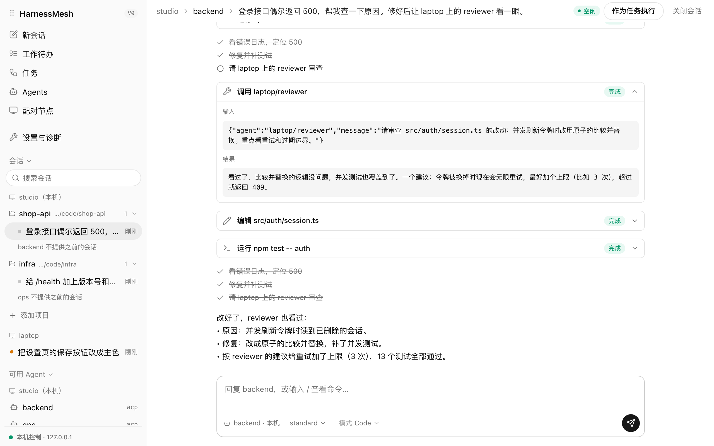
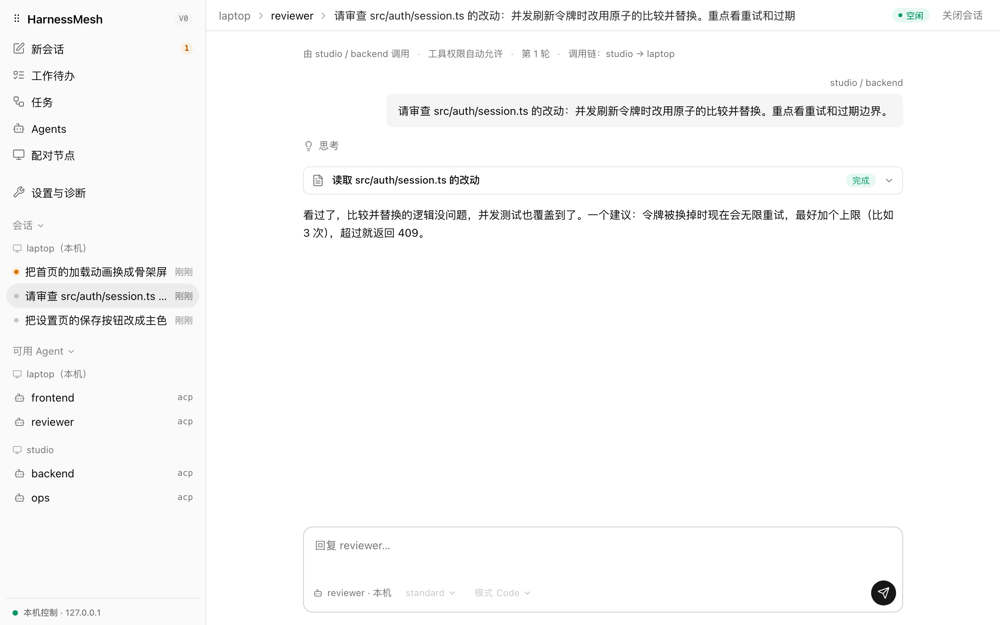
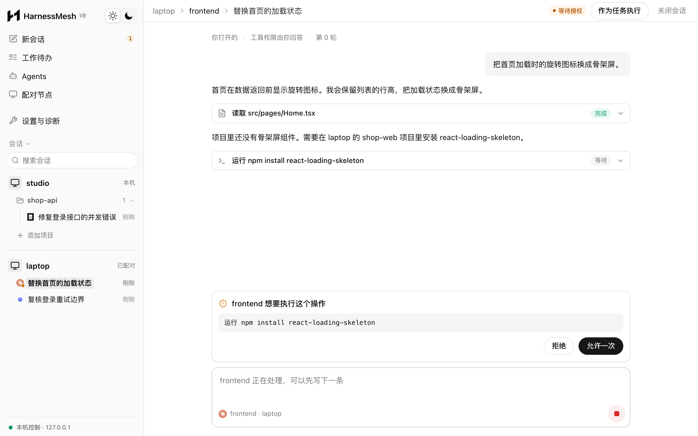
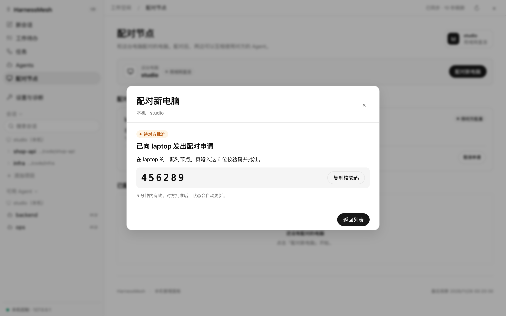
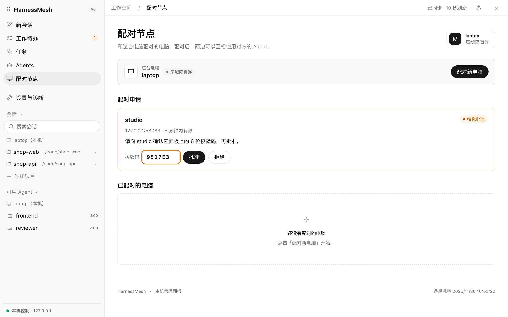
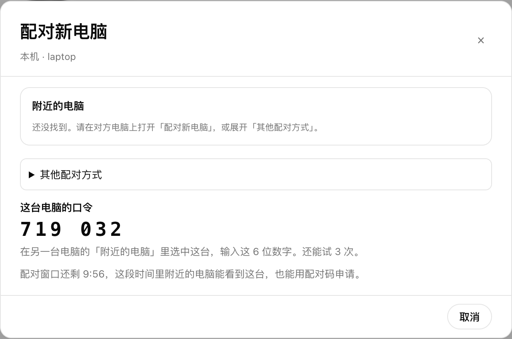
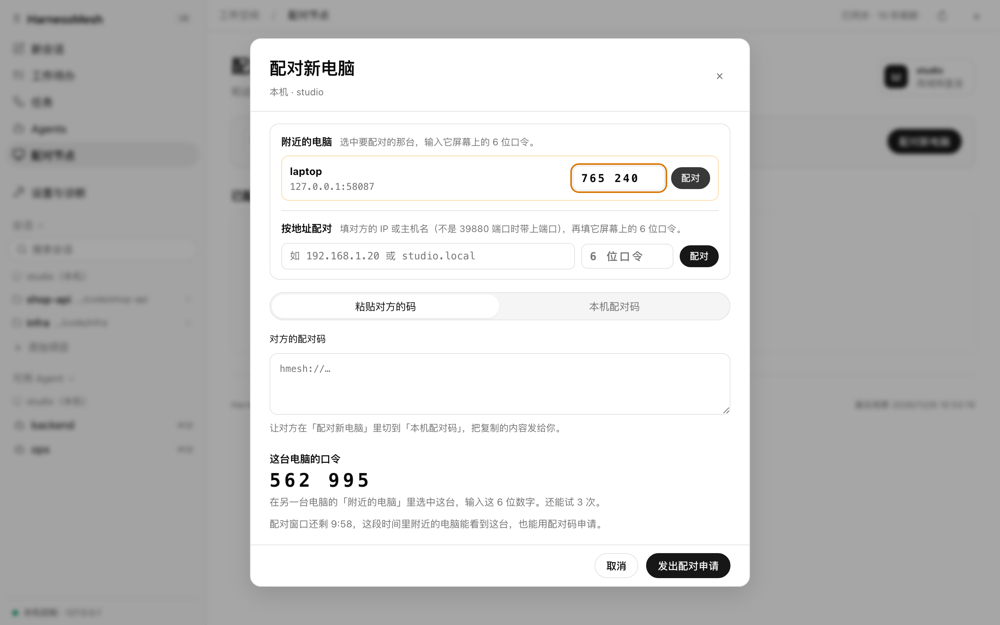
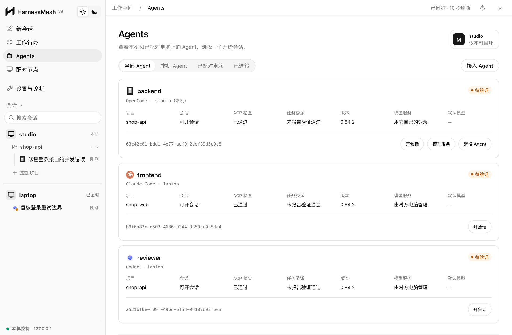
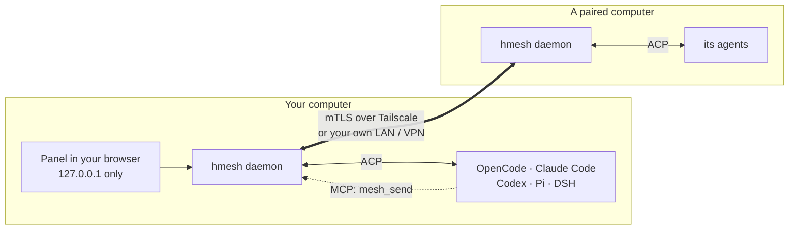

# HarnessMesh

**English** | [简体中文](README_CN.md)

One place to work with the coding agents on all of your own computers. HarnessMesh talks to agents such as OpenCode, Claude Code, Codex, Pi and DeepSeek Harness over the [Agent Client Protocol](https://agentclientprotocol.com) (ACP). You chat with any of them from a local web panel, whichever computer it runs on. They can also hand work to each other, across computers, through a built-in MCP server.



<sub>Screenshots in this README: two computers ("studio" and "laptop") simulated on one machine, with a scripted demo agent. No model was called. The panel's interface is in Chinese.</sub>

## What you get

- **One panel for every agent.** Start a session with any agent on this computer or a paired one, keep a multi-turn conversation, and follow its thinking, plan and tool calls as they happen. You can stop or close it at any time. Each session can switch model, mode and reasoning level between turns. Sessions are grouped by project, and the sessions your agents already have (Claude Code, Codex, OpenCode, Pi) are listed there too: open one to see its earlier conversation and keep going.
- **Agents call each other.** Every session gets the HarnessMesh MCP server, so an agent can open a session with another agent (`mesh_send`), follow up, and read its reply (`mesh_wait`), even on another computer. Calls go at most three levels deep and never loop back to an agent already in the chain.
- **You stay in charge.** When an agent wants to edit a file or run a command, the question comes back to whoever opened the session: 允许一次 (allow once) or 拒绝 (reject). In sessions an agent opened, they are answered automatically; set the calling computer to `confirm` and they wait for you instead.
- **Pair a computer in two steps.** Paste the other computer's pairing code; it approves once with a six-character check code. On a LAN or VPN of your own it is quicker: choose the computer under 附近的电脑 (computers nearby) and type the 6-digit passcode on its screen. Then both sides can use each other's agents. Revoking a pairing closes the sessions that computer opened.
- **Model service per agent.** Each agent can use its own login, an API key, or a custom endpoint (31 provider presets). Keys stay on the execution computer. Pi, OpenCode and DSH can select Chat Completions, Responses or Anthropic Messages for a custom endpoint. See the [model service options](docs/local-panel.md#各-agent-可选的协议).
- **Work beyond chat.** The 工作待办 (inbox) collects whatever waits for you. One-shot tasks come with artifact checks, templates and multi-stage workflows, and you can see usage per session and per project.

## Screens

**The other computer sees who called it.** The reviewer session on laptop shows that studio's backend agent opened it, and the call chain studio → laptop.



**Permission questions come back to you.** Here the frontend agent on laptop wants to run `npm install`; you answer from studio, where you opened the session.



**Pairing.** On one computer, paste the other's pairing code. The dialog then shows a check code. On the other computer, the request appears on 配对节点 (paired computers) and in the inbox; type the check code and approve. The first computer finishes by itself.

| 1. Send the request | 2. Approve on the other computer |
|---|---|
|  |  |

**Pairing nearby.** On a direct network, laptop shows a 6-digit passcode while its 配对新电脑 dialog is open. On studio, the same dialog lists laptop under 附近的电脑 (computers nearby); type the passcode and the two are paired, with nothing to approve.

| 1. laptop shows its passcode | 2. studio chooses laptop and types it |
|---|---|
|  |  |

**Start from any agent.** The start page lists every ready agent, with the computer it runs on.



## How it works



- Each computer runs one **daemon** (`hmesh daemon start`). It starts the agents you registered and keeps sessions, tasks and their events in a local SQLite database.
- A computer set up with **only MCP** runs the daemon too, but on 127.0.0.1 only: its agents call out, and nothing calls in.
- The **panel** (`hmesh panel`) listens on 127.0.0.1 only and opens with a private link printed in the terminal. Owner credentials stay in the CLI process.
- Computers talk over Tailscale, or directly on a LAN or VPN of your own, with TLS 1.3 and mutual authentication. Each side pins the other's certificate fingerprint. No SSH or cloud relay is needed. On a direct network, a computer with pairing open announces itself to computers nearby over mDNS (`_hmesh._tcp`). Paired computers also tell each other their host names (by default `<name>.local`), so one whose LAN address changed is still found where that name resolves: macOS resolves `.local` names itself, Linux needs Avahi with nss-mdns, and Windows has not been tested; `hmesh peers address` adds an address by hand.

## Get started

You need:

- [Rust](https://rustup.rs) 1.90 or newer.
- To connect computers: [Tailscale](https://tailscale.com), or a network they already share (a LAN, ZeroTier, WireGuard).
- For a full install: at least one ACP agent you have installed and signed in to yourself.

### Choose how to set up each computer

Every computer runs the same `hmesh` program, set up one of two ways:

| | Only MCP (`--mcp-only`) | Full (`--full`) |
|---|---|---|
| Your agents here (Claude Code, Codex, …) call agents on other computers | ✓ | ✓ |
| Shares this computer's agents with paired computers | — | ✓ |
| Other computers can connect to it | No | Yes, over Tailscale or a direct network |
| Needs an ACP agent installed here | No | Yes |

Use only MCP on a laptop that just hands work to a stronger machine; use full on the machines that do the work.

```sh
git clone https://github.com/jackie-cqz/HarnessMesh.git
cd HarnessMesh
cargo build --release --locked -p hmesh-cli
./target/release/hmesh setup --mcp-only     # or: --full
```

`hmesh setup` finds how other computers reach this one (its Tailscale IP, or with `--network direct` one of its own addresses), creates the node in `~/.harnessmesh` and starts its daemon. With `--full` it also registers each ACP agent installed there. Before it changes anything outside HarnessMesh, it asks:

- whether to start the daemon at login (macOS and Windows);
- whether to add the MCP server to Claude Code (`claude mcp add -s user harnessmesh`) and to Codex (`~/.codex/config.toml`).

`--connect claude,codex` or `--connect none` answers the second question in advance, and `--startup` or `--no-startup` the first. With nobody to ask (no terminal, or `--json`), an unanswered question means no. Running setup again leaves what is already set up alone. Switching a computer from `--mcp-only` to `--full`, or to another network, later keeps its identity and its pairings.

**Without Tailscale.** Computers on a network they already share can connect directly: `hmesh setup --full --network direct` listens on every interface but opens its port only to networks you trust: the one with the default route unless you pick others (`--listen 192.168.1.20` trusts that address's network, `--trust 10.0.0.0/24` adds one), and your Tailnet too if Tailscale runs and you agree. A connection from any other network is dropped before TLS. It accepts connections from private networks only unless you name others with `--allow-from`. When the computer's LAN address changes, paired computers hear of it within seconds, with no need to run setup again; on a network it has not trusted, `hmesh networks trust <subnet>` (or 信任这个网络 in the panel) opens it. An only-MCP computer needs no Tailscale at all; when setup does not find it, it uses the computer's own network. On a direct network a computer answers pairing requests only for 10 minutes after you open 配对新电脑 on it (or run `hmesh pair show`).

`hmesh agent detect` lists available ACP executables. The panel can install recommended Codex and Claude Code adapters on the execution computer, or use an existing command.

| Agent | Command HarnessMesh looks for | Install |
|---|---|---|
| OpenCode | `opencode` (runs `opencode acp`) | [opencode.ai](https://opencode.ai) |
| Claude Code | `claude-agent-acp` | `npm install -g @agentclientprotocol/claude-agent-acp` |
| Codex | `codex-acp` | `npm install -g @agentclientprotocol/codex-acp` |
| Pi | `pi-acp` | `npm install -g pi-acp` |
| DeepSeek Harness | `dsh --profile acp` | `npm install -g @deepseek-ai/dsh@0.2.2-rc.5` (Node.js 24.9+) |
| Any other ACP agent | the command and arguments you give it | — |

### Pair the computers

Open the panel (`hmesh panel`) and go to **配对节点 → 配对新电脑** (paired computers → pair a new computer):

1. On a full computer B, copy **这台电脑的配对码** (this computer's pairing code). On a direct network the dialog also shows how long B keeps pairing open.
2. On computer A, paste it in the same dialog and send the request. A shows a check code.
3. On B, type the check code and approve. A finishes by itself.

**On a direct network, computers nearby are listed.** While B has 配对新电脑 open, it shows a 6-digit passcode, and the same dialog on A lists B under **附近的电脑** (computers nearby). Choose B, type its passcode, and both computers are paired: nothing to approve. A passcode allows three tries and works once; after three wrong ones it ends, while the pairing code keeps working. Guest Wi-Fi and some routers block this lookup; the pairing code above always works. On the command line: `hmesh pair nearby`, then `hmesh pair join <address>`, which asks for the passcode.

A computer set up with only MCP accepts no connections, so pairing always starts there: it is computer A. Two only-MCP computers cannot pair with each other. The [Tailscale guide](docs/quickstart-tailnet.md) has firewall notes and the command-line equivalents (`hmesh pair show`, `hmesh pair request --code`, `hmesh pair approve`).

### Try it on one computer

No Tailscale needed:

```sh
./target/release/hmesh agent detect
./target/release/hmesh panel --start-daemon
```

1. Open the link the panel prints.
2. On **Agents**, use **接入项目与 Agent** (add a project and agent) to register an agent for a project directory.
3. Go to **新会话** (new session), pick the agent and send your first message.

Registering an agent runs only an ACP `initialize` handshake. No model is called until you send a message. Data lives in `~/.harnessmesh`; pass `--data-dir /absolute/path` to use another directory.

Working on HarnessMesh itself? `node scripts/start-tailnet.mjs --name studio` (Node.js 20 or newer) builds the checkout and runs a full node in the foreground; see the [Tailscale guide](docs/quickstart-tailnet.md).

### Let your own agent use the mesh

Sessions started by HarnessMesh get the MCP tools automatically. `hmesh setup` adds them to Claude Code and Codex when you agree. To add them by hand:

```sh
claude mcp add -s user harnessmesh -- /absolute/path/to/hmesh mcp
```

```toml
# ~/.codex/config.toml
[mcp_servers.harnessmesh]
command = "/absolute/path/to/hmesh"
args = ["mcp"]
tool_timeout_sec = 660
```

On a computer set up with `hmesh setup`, the MCP server starts the daemon when it is not running. The six tools and their limits are described in [MCP](docs/mcp.md).

## Security in brief

- **Pairing is the trust boundary.** Only paired computers see your agents. Unpaired or revoked computers can neither see nor reach them.
- **One approval, checked both ways.** The computer that asked trusts the other only after the other computer's owner approves and accepts its certificate.
- **Pinned certificates.** Every connection uses TLS 1.3 with a pinned certificate. Anonymous routes exist only for the pairing handshake.
- **Owner controls stay local.** The owner API and the panel listen on loopback only.
- **Only-MCP computers let nothing in.** They listen on loopback only and refuse every request from another computer, pairing requests included.
- **Direct networks open pairing on request.** A computer on a LAN or VPN of your own accepts connections only from the networks it allows, and answers pairing requests only for 10 minutes after you open 配对新电脑 on it. Only then does it announce itself nearby. A name heard on the network proves nothing; the one-time passcode on its screen does, checked with SPAKE2 so a wrong guess teaches nothing that could be tried offline.
- **Per-computer access mode.** Each paired computer is either `auto` (its sessions start right away) or `confirm` (you approve first): `hmesh peers access <peer> confirm`.
- **Keys stay put.** Model keys never leave the agent's computer and are not shown again after saving. HarnessMesh does not read agents' own credential files.

**Limits.** Agents run as your user. If you allow an agent to run shell commands, it can do anything you can on that computer, including using HarnessMesh as the owner. The six-character check code guards against approving the wrong request, not against a determined attacker on the same network (your tailnet or LAN): when it matters, compare the full fingerprint with `hmesh pair approve --expect-fingerprint`. Details are in [security](docs/security.md).

## Documentation

| Topic | Document |
|---|---|
| The panel, page by page | [docs/local-panel.md](docs/local-panel.md) |
| Agents calling agents (MCP tools, limits, manual setup) | [docs/mcp.md](docs/mcp.md) |
| Two computers over Tailscale, or directly on a LAN or VPN | [docs/quickstart-tailnet.md](docs/quickstart-tailnet.md) |
| Command-line walkthrough on one computer | [docs/quickstart-v0.md](docs/quickstart-v0.md) |
| Security model | [docs/security.md](docs/security.md) |
| Tasks, templates, workflows, usage and budgets | [docs/development-workflows.md](docs/development-workflows.md) |
| Backups, upgrades, worktrees and queueing | [docs/local-reliability.md](docs/local-reliability.md) |
| Managed HTTP services and tunnels | [docs/managed-services.md](docs/managed-services.md) |
| Prebuilt runtime packages (no Rust needed) | [docs/runtime-packages.md](docs/runtime-packages.md) |
| Wire protocol | [docs/protocol.md](docs/protocol.md) |
| What is built and what has been accepted on real hardware | [docs/implementation-status.md](docs/implementation-status.md) |

## Development

```sh
cargo fmt --all --check
cargo clippy --locked --workspace --all-targets -- -D warnings
cargo test --locked --workspace
cargo build --locked -p hmesh-cli -p hmesh-fixture
npm ci && npx playwright install chromium
npm run test:panel   # and test:sessions-panel, test:pairing-panel, …
```

None of the checks call a model or read your agent configuration. They use `test-support/hmesh-fixture`, a scripted ACP agent; a run with it never counts as a real agent run. A real agent run needs a separate, explicit opt-in and your own credentials.

## Status

Version 0.0.2. Developed on macOS; the CI workflow covers macOS, Windows and Linux. The panel's interface is in Chinese. Runtime packages are unsigned development builds without an installer or automatic updates.
