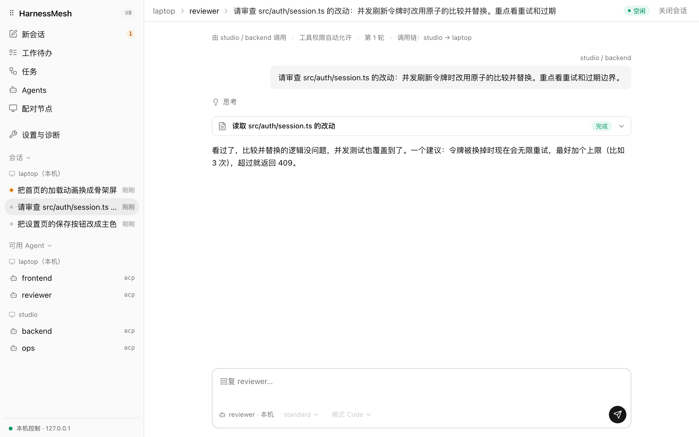
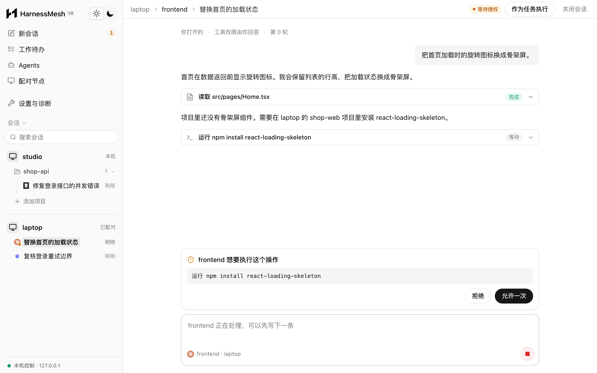
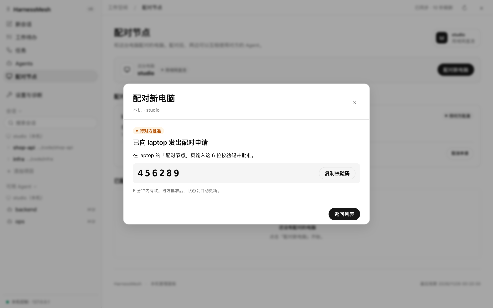
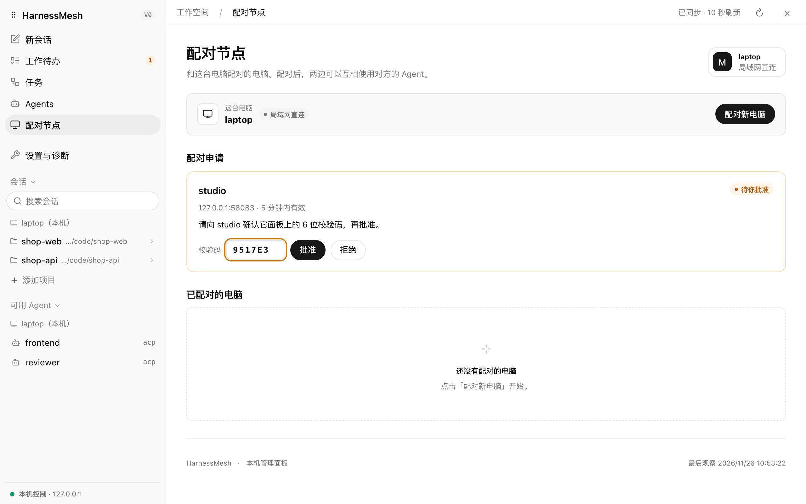
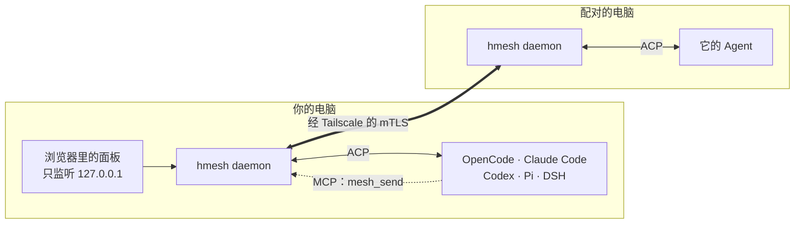

# HarnessMesh

[English](README.md) | **简体中文**

在一个地方使用你所有电脑上的编程 Agent。HarnessMesh 通过 [Agent Client Protocol](https://agentclientprotocol.com)（ACP）连接 OpenCode、Claude Code、Codex、Pi 和 DeepSeek Harness 等 Agent：在本机的网页面板里，不管 Agent 在哪台电脑上，都能直接和它对话；Agent 之间也能通过内置的 MCP 服务器跨电脑互相派活。


<sub>本文截图：在一台电脑上模拟两台电脑（studio 和 laptop），用的是按台词回复的演示 Agent，没有调用任何模型。</sub>

## 能做什么

- **一个面板用所有 Agent。** 和本机或配对电脑上的任意 Agent 开会话、多轮对话，实时看到它的思考、计划和工具调用，随时可以停下或关闭。每一轮之间可以切换模型、模式和推理强度。
- **Agent 互相调用。** 每个会话都自带 HarnessMesh 的 MCP 服务器，Agent 可以和另一个 Agent 开会话（`mesh_send`）、追问、拿回答复（`mesh_wait`），对方在另一台电脑上也一样。调用最多三层，也不会绕回调用链上已有的 Agent。
- **你说了算。** Agent 要改文件或执行命令时，问题会回到打开这个会话的人那里：允许一次，或者拒绝。由 Agent 打开的会话自动允许；把发起调用的电脑设为 `confirm`，就改成等你回答。
- **两步配好一台电脑。** 粘贴对方的配对码，对方输入 6 位校验码批准一次，两边就都能用对方的 Agent。撤销配对会关掉对方打开的会话。
- **每个 Agent 单独配模型服务。** 用 Agent 自己的登录、一个 API key，或者自定义地址（带 31 个服务商预设）。Key 保留在执行端。Pi、OpenCode 和 DSH 可为自定义地址选择 Chat Completions、Responses 或 Anthropic Messages。[模型服务配置](docs/local-panel.md#各-agent-可选的协议)
- **不止聊天。** 「工作待办」汇总所有等你处理的事。还有一次性任务（带产物核验）、任务模板、多阶段工作流，以及按会话、按项目的用量统计。

## 界面

**被调用的电脑知道是谁在调用。** laptop 上的 reviewer 会话写明是 studio 的 backend 打开的，调用链是 studio → laptop。



**权限问题回到你这里。** laptop 上的 frontend 想运行 `npm install`；会话是你在 studio 上打开的，就在 studio 上回答。



**配对。** 在一台电脑上粘贴对方的配对码，弹窗显示校验码；另一台电脑的「配对节点」和「工作待办」里出现这条申请，输入校验码后批准，第一台电脑会自动完成。

| 1. 发出申请 | 2. 在另一台电脑上批准 |
|---|---|
|  |  |

**从任意 Agent 开始。** 首页列出所有可用的 Agent，并标出它在哪台电脑上。


## 原理



- 每台电脑运行一个 **daemon**（`hmesh daemon start`），由它启动你登记的 Agent，并把会话、任务和事件存在本机的 SQLite 数据库里。
- **只装 MCP** 的电脑也跑 daemon，但只监听 127.0.0.1：它的 Agent 往外调用，没有任何东西能调用进来。
- **面板**（`hmesh panel`）只监听 127.0.0.1，用终端里打印的私有链接打开。本机 owner 凭据只留在 CLI 进程里。
- 电脑之间经 Tailscale 通信，使用 TLS 1.3 双向认证，两边都固定对方的证书指纹。不需要 SSH，也不经过云端中转。

## 开始使用

需要：

- [Rust](https://rustup.rs) 1.90 或更新。
- 连接多台电脑时需要 [Tailscale](https://tailscale.com)。
- 完整安装时：至少一个你自己装好并登录过的 ACP Agent。

### 每台电脑选一种装法

每台电脑跑的都是同一个 `hmesh` 程序，有两种装法：

| | 只装 MCP（`--mcp-only`） | 完整安装（`--full`） |
|---|---|---|
| 这台电脑上的 Agent（Claude Code、Codex 等）调用别的电脑上的 Agent | ✓ | ✓ |
| 把这台电脑的 Agent 共享给配对的电脑 | — | ✓ |
| 别的电脑能连进来 | 不能 | 能，经 Tailscale |
| 需要本机装 ACP Agent | 不需要 | 需要 |

只负责派活的笔记本用「只装 MCP」，真正干活的机器用「完整安装」。

```sh
git clone https://github.com/jackie-cqz/HarnessMesh.git
cd HarnessMesh
cargo build --release --locked -p hmesh-cli
./target/release/hmesh setup --mcp-only     # 或者 --full
```

`hmesh setup` 会找出本机的 Tailscale IP，在 `~/.harnessmesh` 创建节点并启动 daemon；`--full` 还会登记本机已装的每个 ACP Agent。改动 HarnessMesh 以外的东西之前，它会先问你：

- 要不要开机自动启动 daemon（macOS 和 Windows）；
- 要不要把 MCP 服务器加到 Claude Code（`claude mcp add -s user harnessmesh`）和 Codex（`~/.codex/config.toml`）。

`--connect claude,codex` 或 `--connect none` 预先回答第二个问题，`--no-startup` 跳过第一个。重复运行不会改动已经装好的部分。以后把一台电脑从 `--mcp-only` 换成 `--full`，它的身份和已有的配对都保留。

HarnessMesh 不会替你安装 Agent。`hmesh agent detect` 会列出找到了哪些，没找到的该怎么装：

| Agent | HarnessMesh 找的命令 | 安装 |
|---|---|---|
| OpenCode | `opencode`（以 `opencode acp` 启动） | [opencode.ai](https://opencode.ai) |
| Claude Code | `claude-agent-acp` | `npm install -g @agentclientprotocol/claude-agent-acp` |
| Codex | `codex-acp` | `npm install -g @zed-industries/codex-acp` |
| Pi | `pi-acp` | `npm install -g pi-acp` |
| DeepSeek Harness | `dsh --profile acp` | `npm install -g @deepseek-ai/dsh@0.2.2-rc.5` (Node.js 24.9+) |
| 其他 ACP Agent | 你填写的命令和参数 | — |

### 配对电脑

打开面板（`hmesh panel`），进入「配对节点」→「配对新电脑」：

1. 在完整安装的电脑 B 上，复制「这台电脑的配对码」。
2. 在电脑 A 的同一个弹窗里粘贴，发出申请。A 会显示一个校验码。
3. 在 B 上输入校验码，批准。A 会自己完成配对。

只装 MCP 的电脑不接受任何连入，所以配对总是从它发起，它就是电脑 A。两台只装 MCP 的电脑之间不能配对。防火墙说明和对应的命令行（`hmesh pair show`、`hmesh pair request --code`、`hmesh pair approve`）见 [Tailscale 指南](docs/quickstart-tailnet.md)。

### 在一台电脑上试用

不需要 Tailscale：

```sh
./target/release/hmesh agent detect
./target/release/hmesh panel --start-daemon
```

1. 打开面板打印出来的链接。
2. 在「Agents」页用「接入项目与 Agent」，给一个项目目录登记 Agent。
3. 到「新会话」，选这个 Agent，发第一条消息。

登记 Agent 只做一次 ACP `initialize` 握手，发消息之前不会调用模型。数据在 `~/.harnessmesh`，想换目录就加 `--data-dir /absolute/path`。

在开发 HarnessMesh 本身？`node scripts/start-tailnet.mjs --name studio`（需要 Node.js 20 或更新）会编译当前仓库，并在前台跑一个完整节点，见 [Tailscale 指南](docs/quickstart-tailnet.md)。

### 让你自己的 Agent 也能调用

HarnessMesh 打开的会话会自动带上 MCP 工具。`hmesh setup` 会在你同意后把它加到 Claude Code 和 Codex。手动添加：

```sh
claude mcp add -s user harnessmesh -- /absolute/path/to/hmesh mcp
```

```toml
# ~/.codex/config.toml
[mcp_servers.harnessmesh]
command = "/absolute/path/to/hmesh"
args = ["mcp"]
tool_timeout_sec = 660
```

用 `hmesh setup` 装过的电脑，daemon 没在运行时 MCP 服务器会自己把它启动起来。六个工具和它们的限制见 [MCP](docs/mcp.md)。

## 安全要点

- **配对就是信任边界。** 只有配对的电脑能看到你的 Agent；没配对或已撤销的电脑既看不到，也调用不了。
- **批准一次，两边都核验。** 发起配对的电脑要等对方 owner 批准、并且对方接受了自己的证书，才信任对方。
- **证书固定。** 每个连接都用 TLS 1.3 并固定证书；匿名接口只用于配对握手。
- **owner 操作只在本机。** owner 接口和面板只监听本机回环地址。
- **只装 MCP 的电脑什么都不放进来。** 它只监听本机回环地址，拒绝别的电脑发来的所有请求，包括配对申请。
- **按电脑设访问模式。** 每台配对电脑可以是 `auto`（它开的会话直接开始）或 `confirm`（先由你批准）：`hmesh peers access <peer> confirm`。
- **key 不离开本机。** 模型 key 不会离开 Agent 所在的电脑，保存后不再显示；HarnessMesh 不读 Agent 自己的凭据文件。

**限制。** Agent 以你的用户身份运行。允许它执行 shell 命令后，它能做你在这台电脑上能做的任何事，包括以 owner 身份使用 HarnessMesh。6 位校验码防的是批准错申请，挡不住 Tailnet 里有备而来的攻击者；要紧的时候，用 `hmesh pair approve --expect-fingerprint` 核对完整指纹。详见 [安全说明](docs/security.md)。

## 文档

| 主题 | 文档 |
|---|---|
| 面板逐页说明 | [docs/local-panel.md](docs/local-panel.md) |
| Agent 互相调用（MCP 工具、限制、手动接入） | [docs/mcp.md](docs/mcp.md) |
| 两台电脑经 Tailscale 连接 | [docs/quickstart-tailnet.md](docs/quickstart-tailnet.md) |
| 单机命令行演练 | [docs/quickstart-v0.md](docs/quickstart-v0.md) |
| 安全模型 | [docs/security.md](docs/security.md) |
| 任务、模板、工作流、用量和预算 | [docs/development-workflows.md](docs/development-workflows.md) |
| 备份、升级、工作树和排队 | [docs/local-reliability.md](docs/local-reliability.md) |
| 受管 HTTP 服务和隧道 | [docs/managed-services.md](docs/managed-services.md) |
| 预编译运行包（不需要 Rust） | [docs/runtime-packages.md](docs/runtime-packages.md) |
| 线上协议 | [docs/protocol.md](docs/protocol.md) |
| 已实现的功能和真机验收记录 | [docs/implementation-status.md](docs/implementation-status.md) |

## 开发

```sh
cargo fmt --all --check
cargo clippy --locked --workspace --all-targets -- -D warnings
cargo test --locked --workspace
cargo build --locked -p hmesh-cli -p hmesh-fixture
npm ci && npx playwright install chromium
npm run test:panel   # 以及 test:sessions-panel、test:pairing-panel 等
```

这些检查都不调用模型，也不读你的 Agent 配置。它们用的是 `test-support/hmesh-fixture`，一个按脚本回复的 ACP Agent，它跑通不算真实 Agent 跑通。真实 Agent 测试需要单独、明确地同意，并使用你自己的凭据。

## 状态

版本 0.0.2。在 macOS 上开发，CI 覆盖 macOS、Windows 和 Linux。面板界面是中文。运行包是未签名的开发版，没有安装器，也不会自动更新。
