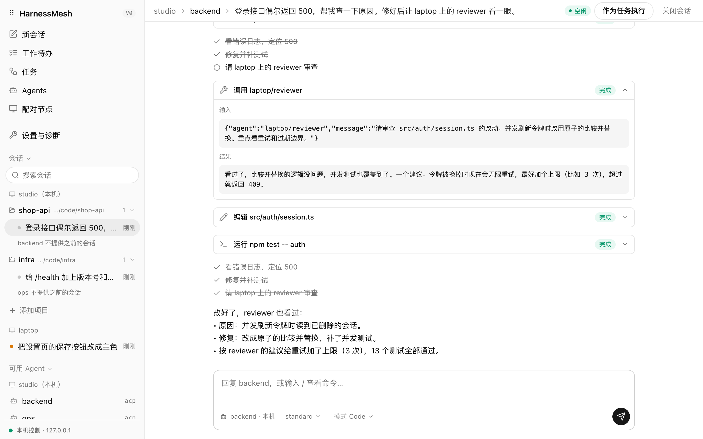
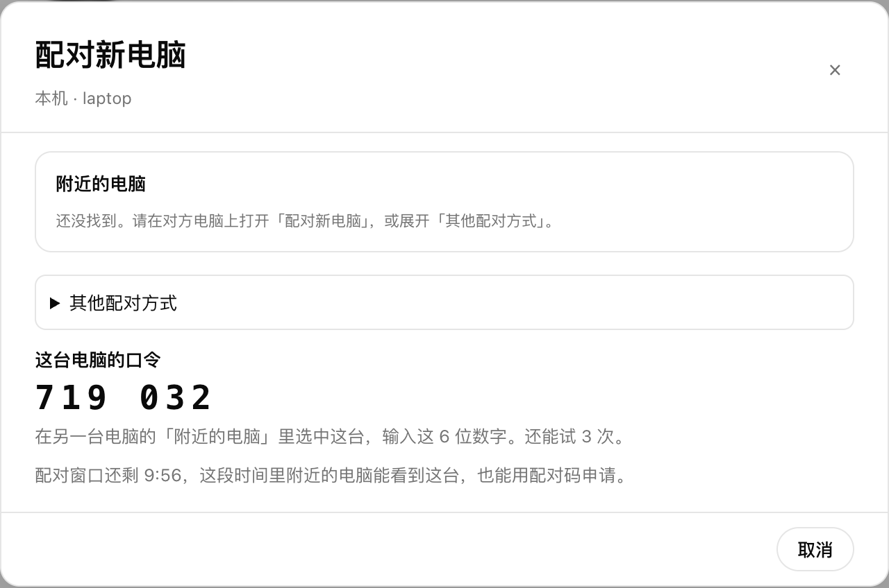
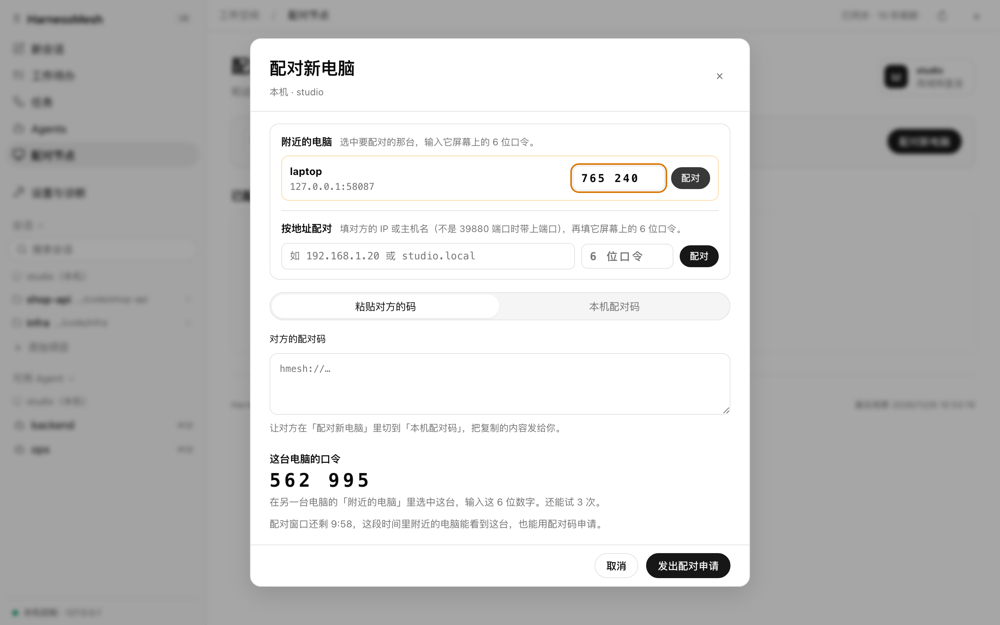
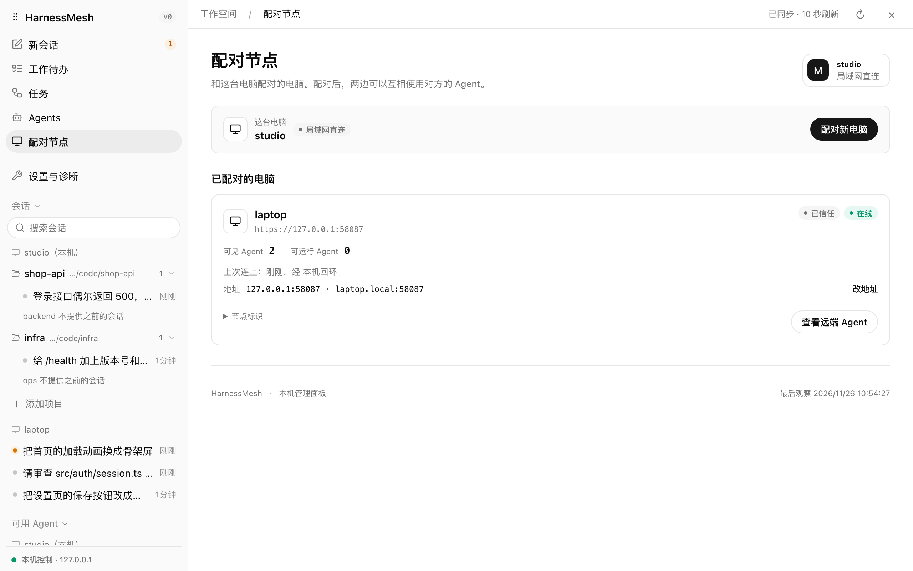
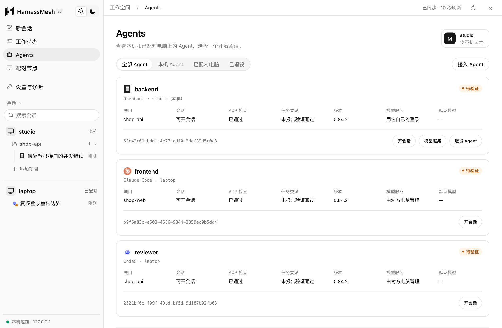
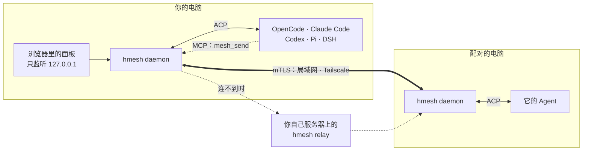

# HarnessMesh

[English](README.md) | **简体中文**

> **早期实验阶段（0.0.x）。** 主要在 Mac 真机上测过，Linux 和 Windows 只测了一部分。请只配对你自己的电脑；详见[状态](#状态)和 [SECURITY.md](SECURITY.md)。

在一个地方使用你所有电脑上的编程 Agent。HarnessMesh 通过 [Agent Client Protocol](https://agentclientprotocol.com)（ACP）连接 OpenCode、Claude Code、Codex、Pi 和 DeepSeek Harness 等 Agent：在本机的网页面板里，不管 Agent 在哪台电脑上，都能直接和它对话；Agent 之间也能通过内置的 MCP 服务器跨电脑互相派活。



<sub>本文截图：在一台电脑上模拟两台电脑（studio 和 laptop），用的是按台词回复的演示 Agent，没有调用任何模型。</sub>

## 能做什么

- **一个面板用所有 Agent。** 和本机或配对电脑上的任意 Agent 开会话、多轮对话，实时看到它的思考、计划和工具调用，随时可以停下或关闭。每一轮之间可以切换模型、模式和推理强度。会话按项目分组，Agent 自己已有的会话（Claude Code、Codex、OpenCode、Pi）也列在里面，点开就能看到之前的对话并接着聊。添加项目时用电脑自带的文件夹选择框选一个文件夹，就能看到各个 Agent 在里面已有的会话。
- **Agent 互相调用。** 每个会话都自带 HarnessMesh 的 MCP 服务器，Agent 可以和另一个 Agent 开会话（`mesh_send`）、追问、拿回答复（`mesh_wait`），对方在另一台电脑上也一样。调用最多三层，也不会绕回调用链上已有的 Agent。
- **你说了算。** Agent 要改文件或执行命令时，问题会回到打开这个会话的人那里：允许一次，或者拒绝。由 Agent 打开的会话自动允许；把发起调用的电脑设为 `confirm`，就改成等你回答。
- **两步配好一台电脑。** 粘贴对方的配对码，对方输入 6 位校验码批准一次，两边就都能用对方的 Agent。在自己的局域网或 VPN 里更省事：在「附近的电脑」里选中对方，输入它屏幕上的 6 位口令就行。撤销配对会关掉对方打开的会话。
- **换了网络也连得上。** 局域网、Tailscale 和主机名一起用：电脑换了 IP，配对的电脑自己找回来；到了没认过的网络不开端口，只往外连；两台都在 NAT 后面时，经你自己服务器上的中继连。
- **每个 Agent 单独配模型服务。** 用 Agent 自己的登录、一个 API key，或者自定义地址（带 31 个服务商预设）。Key 保留在执行端。Pi、OpenCode 和 DSH 可为自定义地址选择 Chat Completions、Responses 或 Anthropic Messages。[模型服务配置](docs/local-panel.md#各-agent-可选的协议)
- **不止聊天。** 「工作待办」汇总所有等你处理的事。还有一次性任务（带产物核验）、任务模板、多阶段工作流，以及按会话、按项目的用量统计。

## 界面

**被调用的电脑知道是谁在调用。** laptop 上的 reviewer 会话写明是 studio 的 backend 打开的，调用链是 studio → laptop。


**权限问题回到你这里。** laptop 上的 frontend 想运行 `npm install`；会话是你在 studio 上打开的，就在 studio 上回答。


**配对。** 在一台电脑上粘贴对方的配对码，弹窗显示校验码；另一台电脑的「配对节点」和「工作待办」里出现这条申请，输入校验码后批准，第一台电脑会自动完成。

| 1. 发出申请 | 2. 在另一台电脑上批准 |
|---|---|
|  |  |

**附近的电脑。** 直连网络里，laptop 打开「配对新电脑」时会显示一个 6 位口令；studio 的同一个弹窗在「附近的电脑」里列出 laptop，输入口令就配好了，谁都不用再批准。

| 1. laptop 显示口令 | 2. studio 选中 laptop，输入口令 |
|---|---|
|  |  |

**已配对的电脑。** 卡片上写着它的地址，和上次什么时候、经哪条路连上；连不上时直接说原因（被防火墙挡了、主机名解析不出来、那个地址上是另一台电脑等）。「改地址」可以手动加一个地址。



**从任意 Agent 开始。** 首页列出所有可用的 Agent，并标出它在哪台电脑上。



## 原理



- 每台电脑运行一个 **daemon**（`hmesh daemon start`），由它启动你登记的 Agent，并把会话、任务和事件存在本机的 SQLite 数据库里。
- **只装 MCP** 的电脑也跑 daemon，但只监听 127.0.0.1：它的 Agent 往外调用，没有任何东西能调用进来。
- **面板**（`hmesh panel`）只监听 127.0.0.1，用终端里打印的私有链接打开。本机 owner 凭据只留在 CLI 进程里。
- 电脑之间都用 TLS 1.3 双向认证，两边固定对方的证书指纹，不需要 SSH，也不需要云服务。怎么找到对方见下表。

| 怎么连 | 什么时候用 | 说明 |
|---|---|---|
| 局域网直连 | 在同一个网络里 | 在所有网卡上监听，只对你认过的网络开门；从没认过的网络进来的连接在 TLS 之前就断开 |
| Tailscale | 电脑分散在各地 | 可以和局域网同时用；只有 Tailscale 自己确认的地址才算 Tailnet |
| 主机名 | 局域网地址常变 | 配对的电脑互相告诉主机名（默认 `本机名.local`）。macOS 自带解析，Linux 要装 Avahi 和 nss-mdns，Windows 还没测过 |
| 在局域网里认出来 | 地址变了，名字也解析不了 | 接受连入的电脑在认过的网络上广播一个只有配对的电脑算得出的标记（`_hmesh-find._tcp`，每 10 分钟换一个，不带电脑名和指纹） |
| 中继 | 两边都在 NAT 后面，或者 Wi-Fi 开了客户端隔离 | 在你自己的服务器上运行 `hmesh relay serve`，它只转发两台电脑之间的 TLS，看不到内容 |
| 手动地址 | 以上都不行 | `hmesh peers address`，或者面板卡片上的「改地址」 |

调用配对的电脑时，按上次连上的那条、名片地址、手动地址、对方告诉的地址依次试，哪条通走哪条。只有请求还没发出去时才换下一条，同一个写请求不会执行两次。直连网络里，打开了配对的电脑还会用 mDNS（`_hmesh._tcp`）让附近的电脑看到它。

## 开始使用

需要：

- [Rust](https://rustup.rs) 1.90 或更新。
- 连接多台电脑：用 [Tailscale](https://tailscale.com)，或者它们本来就连得通的网络（局域网、ZeroTier、WireGuard），或者一台两边都连得到的服务器（见 [docs/cloud-server.md](docs/cloud-server.md)）。
- 完整安装时：至少一个你自己装好并登录过的 ACP Agent。

### 每台电脑选一种装法

每台电脑跑的都是同一个 `hmesh` 程序，有两种装法：

| | 只装 MCP（`--mcp-only`） | 完整安装（`--full`） |
|---|---|---|
| 这台电脑上的 Agent（Claude Code、Codex 等）调用别的电脑上的 Agent | ✓ | ✓ |
| 把这台电脑的 Agent 共享给配对的电脑 | — | ✓ |
| 别的电脑能连进来 | 不能 | 能：局域网、Tailscale 或中继 |
| 需要本机装 ACP Agent | 不需要 | 需要 |

只负责派活的笔记本用「只装 MCP」，真正干活的机器用「完整安装」。

```sh
git clone https://github.com/jackie-cqz/HarnessMesh.git
cd HarnessMesh
cargo build --release --locked -p hmesh-cli
./target/release/hmesh setup --mcp-only     # 或者 --full
```

`hmesh setup` 会找出别的电脑怎么连到这台（它的 Tailscale IP，或者用 `--network direct` 时本机的某个地址），在 `~/.harnessmesh` 创建节点并启动 daemon；`--full` 还会登记本机已装的每个 ACP Agent。改动 HarnessMesh 以外的东西之前，它会先问你：

- 要不要开机自动启动 daemon（macOS 和 Windows）；
- 要不要把 MCP 服务器加到 Claude Code（`claude mcp add -s user harnessmesh`）和 Codex（`~/.codex/config.toml`）。

`--connect claude,codex` 或 `--connect none` 预先回答第二个问题，`--startup` 或 `--no-startup` 回答第一个。没人可问时（没有终端，或者用了 `--json`），没预先回答的一律当作不要。重复运行不会改动已经装好的部分。以后把一台电脑从 `--mcp-only` 换成 `--full`，或者换一种网络，它的身份和已有的配对都保留。

**不用 Tailscale。** 在同一个网络里的电脑可以直连：`hmesh setup --full --network direct`。

- 它在所有网卡上监听，但只对你认过的网络开门。setup 列出本机所在的网络让你选（有默认路由的那个排在前面）；`--listen 192.168.1.20` 认这个地址所在的网络，`--trust 10.0.0.0/24` 再认一个；Tailscale 在运行时，经你同意也认你的 Tailnet（`--with-tailscale` 预先回答）。没人可问时，只认这些参数写明的。
- 网络按网段加路由器的硬件地址来认。读不到硬件地址时只按网段认，setup、`hmesh networks` 和面板都会注明：同网段的别的网络也会被当成认过。
- 默认只接受私有网段的连接，要放行别的网段就用 `--allow-from`。
- 局域网地址变了，配对的电脑几秒内就知道，不用重跑 setup。到了没认过的网络，用 `hmesh networks trust <子网>` 或面板里的「信任这个网络」认下它；`hmesh networks list` 看现在认了哪些。
- 只有在你打开这台电脑的「配对新电脑」（或者运行 `hmesh pair show`）之后的 10 分钟内，它才接受配对申请。

只装 MCP 的电脑完全不需要 Tailscale：setup 找不到它时，就用本机自己的网络。

`hmesh agent detect` 会列出可用的 ACP 命令。可直接使用已装好的命令，也可以在执行端的面板中安装推荐版本的 Codex、Claude Code、Pi 或 DeepSeek Harness 适配器。Pi 的适配器需要先装好 Pi 本体；DeepSeek Harness 需要 Node.js 24.9+，默认的 `node` 版本不够时，面板会改用本机找到的更新版本。

| Agent | HarnessMesh 找的命令 | 安装 |
|---|---|---|
| OpenCode | `opencode`（以 `opencode acp` 启动） | [opencode.ai](https://opencode.ai) |
| Claude Code | `claude-agent-acp` | `npm install -g @agentclientprotocol/claude-agent-acp` |
| Codex | `codex-acp` | `npm install -g @agentclientprotocol/codex-acp` |
| Pi | `pi-acp` | `npm install -g pi-acp` |
| DeepSeek Harness | `dsh --profile acp` | `npm install -g @deepseek-ai/dsh@0.2.2-rc.5` (Node.js 24.9+) |
| 其他 ACP Agent | 你填写的命令和参数 | — |

### 配对电脑

打开面板（`hmesh panel`），进入「配对节点」→「配对新电脑」：

1. 在完整安装的电脑 B 上，复制「这台电脑的配对码」。直连网络里，弹窗还会显示 B 的配对窗口还剩多久。
2. 在电脑 A 的同一个弹窗里粘贴，发出申请。A 会显示一个校验码。
3. 在 B 上输入校验码，批准。A 会自己完成配对。

**直连网络里，附近的电脑会列出来。** B 打开「配对新电脑」时会显示一个 6 位口令，A 的同一个弹窗里「附近的电脑」会列出 B。选中 B、输入它的口令，两台电脑就配好了，谁都不用再批准。一个口令只能试 3 次，用一次就作废；错满 3 次口令作废，配对码照样能用。访客 Wi-Fi 和一些路由器会挡住这种查找，另一个网段的电脑也听不到：在「按地址配对」里填它的 IP 或主机名和同一个口令（不带端口就用 39880），或者照旧用上面的配对码。命令行：先 `hmesh pair nearby`，再 `hmesh pair join <地址>`，它会让你输入口令。

**经中继。** 两台电脑完全连不到对方时（都在 NAT 后面，或者公司 Wi-Fi 开了客户端隔离），在一台两边都连得到的服务器上运行中继：

1. 服务器上：`hmesh relay serve --listen 0.0.0.0:7443 --dir ~/hmesh-relay --public-address <公网 IP>:7443`，它打印一行中继码（`hmesh relay show --dir ~/hmesh-relay` 再打印一次）。
2. 要被找到的电脑上：运行 `hmesh relay use`，在提示时粘贴中继码，令牌就不会留在 shell 历史里。它会一直连着中继，在没认过的网络上也一样；配对的电脑随地址列表拿到这个中继。
3. 第一次配对：那台电脑的 `hmesh pair show` 会多打印一行中继配对码（`hmesh-relay://…`），面板和 `hmesh pair request --code`（在提示时粘贴）都像普通配对码一样接受它。

中继能看到哪两台电脑在通话、什么时候、多少流量，看不到内容，也冒充不了任何一台。中继后面的电脑只接和它配对了的电脑，别的电脑只在它打开配对时才接。中继码别外传：拿到它的人就能用这台中继；撤销一台拿过中继码的电脑后，用 `hmesh relay show --rotate-token` 给中继换一个新令牌。目前只在一台电脑上模拟过，还没在真实服务器上跑过。在云服务器上怎么跑、连接有哪些上限，见 [docs/cloud-server.md](docs/cloud-server.md) 和 [docs/security.md](docs/security.md)。

只装 MCP 的电脑不接受任何连入，所以配对总是从它发起，它就是电脑 A。两台只装 MCP 的电脑之间不能配对。防火墙说明和对应的命令行（`hmesh pair show`、`hmesh pair request --code`、`hmesh pair approve`）见 [Tailscale 指南](docs/quickstart-tailnet.md)。

### 在一台电脑上试用

不需要 Tailscale：

```sh
./target/release/hmesh agent detect
./target/release/hmesh panel --start-daemon
```

1. 打开面板打印出来的链接。
2. 在「Agents」页用「接入项目与 Agent」，给一个项目目录登记 Agent。
3. 到「新会话」，选这个 Agent，发第一条消息。

登记 Agent 只做一次 ACP `initialize` 握手，发消息之前不会调用模型。数据在 `~/.harnessmesh`，想换目录就加 `--data-dir /absolute/path`。

在开发 HarnessMesh 本身？`node scripts/start-tailnet.mjs --name studio`（需要 Node.js 20 或更新）会编译当前仓库，并在前台跑一个完整节点，见 [Tailscale 指南](docs/quickstart-tailnet.md)。

### 让你自己的 Agent 也能调用

HarnessMesh 打开的会话会自动带上 MCP 工具。`hmesh setup` 会在你同意后把它加到 Claude Code 和 Codex。手动添加：

```sh
claude mcp add -s user harnessmesh -- /absolute/path/to/hmesh mcp
```

```toml
# ~/.codex/config.toml
[mcp_servers.harnessmesh]
command = "/absolute/path/to/hmesh"
args = ["mcp"]
tool_timeout_sec = 660
```

用 `hmesh setup` 装过的电脑，daemon 没在运行时 MCP 服务器会自己把它启动起来。六个工具和它们的限制见 [MCP](docs/mcp.md)。

## 安全要点

- **配对就是信任边界。** 只有配对的电脑能看到你的 Agent；没配对或已撤销的电脑既看不到，也调用不了。
- **批准一次，两边都核验。** 发起配对的电脑要等对方 owner 批准、并且对方接受了自己的证书，才信任对方。
- **证书固定。** 每个连接都用 TLS 1.3 并固定证书；匿名接口只用于配对握手。
- **owner 操作只在本机。** owner 接口和面板只监听本机回环地址。
- **只装 MCP 的电脑什么都不放进来。** 它只监听本机回环地址，拒绝别的电脑发来的所有请求，包括配对申请。
- **直连网络按需开放配对。** 用自己的局域网或 VPN 的电脑，只接受允许网段的连接，并且只在你打开「配对新电脑」后的 10 分钟内回应配对申请，也只在这段时间里让附近的电脑看到它。网络上听到的名字证明不了什么，确认身份靠它屏幕上的一次性口令：口令用 SPAKE2 核对，猜错一次拿不到任何能离线试的东西。
- **只对认过的网络开门。** 监听所有网卡的电脑，从没认过的网络进来的连接在 TLS 之前就断开；网络不再被认时，已经开着的连接也会被关掉。运营商和酒店的 Wi-Fi 也会发 100.64 开头的地址，只有 Tailscale 自己确认的才算 Tailnet。
- **找回标记不暴露身份。** 广播的标记只有配对的电脑算得出，每 10 分钟换一个，不带电脑名和指纹；撤销配对会换掉背后的密钥。
- **中继看不到内容。** 经中继的连接里仍是两台电脑之间的 TLS，中继只转发字节；中继码和令牌不进日志，交给电脑时从标准输入读。
- **按电脑设访问模式。** 每台配对电脑可以是 `auto`（它开的会话直接开始）或 `confirm`（先由你批准）：`hmesh peers access <peer> confirm`。
- **key 不离开本机。** 模型 key 不会离开 Agent 所在的电脑，保存后不再显示；HarnessMesh 不读 Agent 自己的凭据文件。

**限制。** Agent 以你的用户身份运行。允许它执行 shell 命令后，它能做你在这台电脑上能做的任何事，包括以 owner 身份使用 HarnessMesh。6 位校验码防的是批准错申请，挡不住同一网络（Tailnet 或局域网）里有备而来的攻击者；要紧的时候，用 `hmesh pair approve --expect-fingerprint` 核对完整指纹。详见 [安全说明](docs/security.md)。

## 文档

| 主题 | 文档 |
|---|---|
| 面板逐页说明 | [docs/local-panel.md](docs/local-panel.md) |
| Agent 互相调用（MCP 工具、限制、手动接入） | [docs/mcp.md](docs/mcp.md) |
| 两台电脑经 Tailscale 或局域网直连 | [docs/quickstart-tailnet.md](docs/quickstart-tailnet.md) |
| 两台电脑都在 NAT 后面：经一台云服务器连 | [docs/cloud-server.md](docs/cloud-server.md) |
| 单机命令行演练 | [docs/quickstart-v0.md](docs/quickstart-v0.md) |
| 安全模型 | [docs/security.md](docs/security.md) |
| 任务、模板、工作流、用量和预算 | [docs/development-workflows.md](docs/development-workflows.md) |
| 备份、升级、工作树和排队 | [docs/local-reliability.md](docs/local-reliability.md) |
| 受管 HTTP 服务和隧道 | [docs/managed-services.md](docs/managed-services.md) |
| 预编译运行包（不需要 Rust） | [docs/runtime-packages.md](docs/runtime-packages.md) |
| 线上协议 | [docs/protocol.md](docs/protocol.md) |
| 已实现的功能和真机验收记录 | [docs/implementation-status.md](docs/implementation-status.md) |

## 开发

```sh
cargo fmt --all --check
cargo clippy --locked --workspace --all-targets -- -D warnings
cargo test --locked --workspace
cargo build --locked -p hmesh-cli -p hmesh-fixture
npm ci && npx playwright install chromium
npm run test:panel   # 以及 test:sessions-panel、test:pairing-panel 等
```

这些检查都不调用模型，也不读你的 Agent 配置。它们用的是 `test-support/hmesh-fixture`，一个按脚本回复的 ACP Agent，它跑通不算真实 Agent 跑通。真实 Agent 测试需要单独、明确地同意，并使用你自己的凭据。

## 状态

版本 0.0.2。在 macOS 上开发，CI 覆盖 macOS、Windows 和 Linux。面板界面是中文。运行包是未签名的开发版，没有安装器，也不会自动更新。

## 许可证

Apache License 2.0，见 [LICENSE](LICENSE)。来自其他项目的代码和图标的声明见 [THIRD_PARTY_NOTICES.md](THIRD_PARTY_NOTICES.md)。报告漏洞请看 [SECURITY.md](SECURITY.md)。
