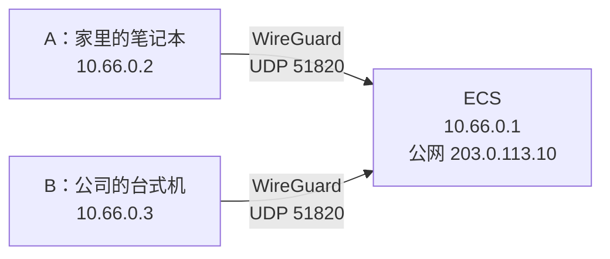
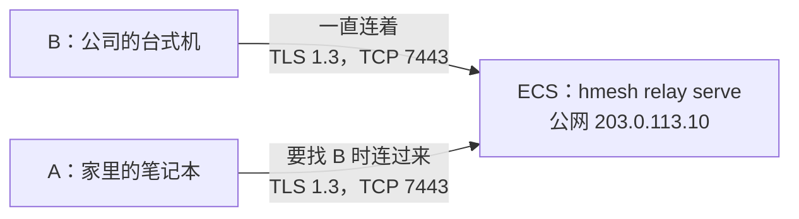

# 两台电脑都在 NAT 后面：经一台云服务器连

> **这一页没有实测。** 内容按官方资料整理（见文末「依据」，2026-11-26 查阅，对照的是 Tailscale v1.104.7、Headscale v0.29.7 的文档和源码），还没有在真实的 ECS 上从头走过一遍。写着「没证实」的地方，是官方资料没写清、或者各方说法不一致。照着做遇到出入时，以官方文档为准。做法三（HarnessMesh 自带的中继）按的是本仓库的代码和测试，只在一台电脑上模拟过（中继和两台电脑都在本机），同样没在真实的 ECS 上跑过。

一台电脑在家、一台在公司，都在 NAT 后面；或者公司 Wi-Fi 开了客户端隔离，同一层楼的两台也互相连不到。HarnessMesh 自己不打洞，这时要在中间放一台有公网 IP 的云服务器搭桥。下面都叫它 ECS，别家的云服务器也一样。

- **已经在用 Tailscale**：用做法一，在 ECS 上自建 Tailscale 中继（DERP）。能打洞时两台照旧直连，打不通才经过 ECS。
- **不想用 Tailscale**：用做法二，让 ECS 当 WireGuard 中心。两台电脑都连到 ECS，所有流量经 ECS 转发。
- **Tailscale 和 WireGuard 都不想装**：用做法三，在 ECS 上跑 HarnessMesh 自带的中继（`hmesh relay serve`）。要被找到的电脑一直往外连着它；两台都在 NAT 后面时，所有流量经 ECS 转发。

做法一、二 HarnessMesh 都不用改，ECS 上也不装 HarnessMesh；做法三在 ECS 上只放一个 `hmesh` 程序跑中继。三种做法里电脑之间照旧是 TLS 1.3 双向认证、固定证书指纹：ECS 看不到会话内容，也冒充不了任何一台电脑。

## 先看需不需要

| 情况 | 要不要这一页 |
|---|---|
| 两台在同一个局域网，互相 ping 得通 | 不用。`hmesh setup --full --network direct` 就行，见 [Tailscale 指南](quickstart-tailnet.md) |
| 两台都登录了 Tailscale，`tailscale ping <对方>` 有回应 | 不用。打不通时 Tailscale 会自动走它官方的中继；嫌慢再看做法一 |
| 都在 NAT 后面，也没有共同的 VPN | 要 |
| 公司 Wi-Fi 开了客户端隔离 | 要 |

Tailscale 官方的中继地图里没有中国大陆的节点，最近的是香港（2026-11-26 查的默认地图）。在大陆经官方中继要绕到境外，通常更慢（按距离推断，没测过），这是自建中继最常见的理由。

## 三种做法怎么选

| | 做法一：自建 Tailscale 中继（DERP） | 做法二：ECS 当 WireGuard 中心 | 做法三：内置中继（`hmesh relay`） |
|---|---|---|---|
| ECS 上跑什么 | `derper`，建议再装一个 Tailscale 用来核对客户端；可选再加 Headscale | WireGuard，打开 IP 转发 | `hmesh relay serve`，一个程序，不要 daemon |
| 每台电脑装什么 | Tailscale，登录同一个 tailnet | WireGuard 和一份配置 | 什么都不用加装；要被找到的电脑 `hmesh relay use` 一次 |
| 流量是否都经过 ECS | 不是。能打洞就直连，打不通才经过 ECS | 是，全部经过 | 先试名片上的直连地址，连不上才经过 ECS（上次连上的那条下次先试）；两台都在 NAT 后面时就是全部经过 |
| HarnessMesh 用哪种网络 | Tailscale 模式，照常 `--network tailscale` | 直连模式 `--network direct`，监听 WireGuard 的 10.x 地址 | 照常用原来的模式；中继是地址列表里多出来的一条路 |
| ECS 安全组要放行 | TCP：DERP 端口（本文用 8443）；UDP 3478（STUN）；ICMP | UDP 51820（或你选的端口） | TCP 一个端口（本文用 7443） |
| 证书和域名 | 只用 IP 时，derper 自签一张证书，把指纹写进 DERP 地图 | 都不需要 | 都不需要：中继自签证书，指纹写在中继码里 |
| 日常维护 | derper 要跟着 Tailscale 更新重新编译；自签证书一年到期 | 加一台电脑要改 ECS 的配置 | 换 HarnessMesh 版本时一起换 ECS 上的 `hmesh`；加电脑不用改 ECS |
| 验证情况 | 按官方资料整理，没实测 | 按官方资料整理，没实测 | 只在一台电脑上模拟过，没在真实 ECS 上跑过 |
| 适合 | 已经在用 Tailscale，想尽量直连、少走 ECS | 不想要 Tailscale 账号；就两三台电脑，配置不常变 | 不想装 Tailscale 也不想配 WireGuard；只要 HarnessMesh 的电脑互相找得到 |

不管哪种做法，ECS 安全组都**不要**放行 HarnessMesh 的 39880 端口：做法一、二里它的流量走在 Tailscale 或 WireGuard 的隧道里；做法三里两台电脑都是往外连 ECS 的中继端口。ECS 上也没有 HarnessMesh 在监听 39880。

## 做法一：自建 Tailscale 中继（DERP）

### 要准备什么

- 一台 Linux ECS，有固定的公网 IPv4，有 IPv6 更好。官方要求 DERP 直接连在公网上：前面不能有负载均衡或 HTTP 代理，入站和出站都要放行 ICMP。
- 最新版 Go。derper 没有现成的软件包，要自己编译。
- 两台电脑都装好 Tailscale，登录同一个 tailnet。
- 一个能改 tailnet 访问控制（policy file）的账号。

自定义 DERP 在 Tailscale 官方文档里还标着 alpha。

### 1. 在 ECS 上装 Tailscale 和 derper

`--verify-clients` 让 derper 只服务你自己 tailnet 里的设备，不然谁知道这个 IP 都能把它加进自己的 DERP 地图、蹭你的流量。它要求 ECS 上同时跑着 tailscaled；官方要求 derper 和 tailscaled 用同一个版本编译（不一致也许能跑，但只一起测过）：

```sh
# 装 Tailscale，登录你的 tailnet（官方安装脚本）
curl -fsSL https://tailscale.com/install.sh | sh
sudo tailscale up
tailscale version              # 记下版本号，比如 1.104.7

# 编译同一个版本的 derper，放到 /usr/local/bin
go install tailscale.com/cmd/derper@v1.104.7
sudo install -m 755 ~/go/bin/derper /usr/local/bin/derper
```

- 大陆 ECS 拉 Go 模块慢时，可以先设 `GOPROXY`，比如第三方的 `https://goproxy.cn`。
- ECS 是长期在线的服务器，可以在 Tailscale 管理后台的 Machines 页给它关掉 key 过期（Disable key expiry），免得它过期掉线、`--verify-clients` 跟着用不了（这一条是推断）。官方提醒这样会降低安全性，只对你信得过的机器这么做。

### 2. 启动 derper，只用 IP

```sh
sudo derper -a :8443 -http-port -1 -stun-port 3478 \
  -certmode manual -certdir /var/lib/derper -hostname 203.0.113.10 \
  -verify-clients
```

`203.0.113.10` 换成你 ECS 的公网 IP，下同。

| 参数 | 意思 |
|---|---|
| `-a :8443` | DERP 的 HTTPS 端口，默认 443。大陆 ECS 建议用自选端口，原因见「注意事项」 |
| `-http-port -1` | 不开 80 端口。照 derper 源码，80 用来签 Let's Encrypt 证书、做强制门户（captive portal）检测、把 HTTP 跳转到 HTTPS，自签证书用不到。官方文档把 80 列在必开端口里，关掉对中继有没有别的影响，没证实 |
| `-stun-port 3478` | STUN 的 UDP 端口，帮客户端找到自己的公网地址、打洞。默认就是 3478 |
| `-certmode manual -hostname <IP>` | `-hostname` 写 IP 时，derper 第一次启动会在 `-certdir` 里生成一张一年有效的自签证书 |
| `-verify-clients` | 只让本 tailnet 的设备用，靠同一台机器上的 tailscaled 核对。照 derper 源码，查不到这台设备、或者问本机 tailscaled 出错，都直接拒绝，不会默认放行 |

第一次启动，日志里会打印一行这样的内容（照 derper 源码写的）：

```text
Using self-signed certificate for IP address "203.0.113.10". Configure it in DERPMap using: (https://tailscale.com/s/custom-derp)
  {"Name":"custom","RegionID":900,"HostName":"203.0.113.10","CertName":"sha256-raw:…"}
```

把 `CertName` 那一串整个抄下来，下一步要用。

确认能跑之后，可以交给 systemd 常驻。下面是一个示例，官方不提供软件包和服务文件：

```ini
# /etc/systemd/system/derper.service
[Unit]
Description=Tailscale DERP server
After=network-online.target tailscaled.service
Wants=network-online.target

[Service]
ExecStart=/usr/local/bin/derper -a :8443 -http-port -1 -stun-port 3478 -certmode manual -certdir /var/lib/derper -hostname 203.0.113.10 -verify-clients
Restart=always

[Install]
WantedBy=multi-user.target
```

```sh
sudo systemctl daemon-reload
sudo systemctl enable --now derper
journalctl -u derper          # 在这里找 CertName 那一行
```

### 3. 放行端口

在 ECS 控制台的安全组里加入方向规则；ECS 系统里如果开着 ufw、firewalld，也一样放行。

| 协议 | 端口 | 用途 |
|---|---|---|
| TCP | 8443（你在 `-a` 里选的） | DERP |
| UDP | 3478 | STUN |
| ICMP | — | 官方要求入站、出站都放行 |
| TCP | 80 | 只有用 Let's Encrypt 证书时才要。本文的做法不开 |

derper 的说明里还写了：前面的防火墙不能吞掉 TCP 的 RST，不要限速 UDP 的 STUN 包，不要限速出站 TCP。

### 4. 把它加进 tailnet 的 DERP 地图

打开 Tailscale 管理后台的 Access controls，在 policy file 里加一个 `derpMap`：

```jsonc
{
  // ……原有的 grants / acls 等保持不动
  "derpMap": {
    "Regions": {
      "900": {
        "RegionID": 900,
        "RegionCode": "myecs",
        "RegionName": "My ECS",
        "Nodes": [
          {
            "Name": "900a",
            "RegionID": 900,
            "HostName": "203.0.113.10",
            "IPv4": "203.0.113.10",
            "DERPPort": 8443,
            "STUNPort": 3478,
            "CertName": "sha256-raw:<derper 日志里打印的那串>"
          }
        ]
      }
    }
  }
}
```

- 区域 ID 900 到 999 留给自定义区域。一个区域放几台，两份官方资料说法不同：KB 写的是「一个区域只能有一台 DERP，要冗余就用多个区域、每个区域一台」；derper 的说明写的是「尽量别在一个区域放多台，非放不可就要让它们互相 mesh 并监控」。本文一个区域只放一台，要备份就再开一个区域，两份说法都认这种做法。
- `IPv4` 必须是公网地址。有 IPv6 就加一行 `"IPv6"`。
- `CertName` 以 `sha256-raw:` 开头时，客户端不看证书由谁签发，只核对证书的 SHA-256。这是给自签证书用的。
- 先别加 `"OmitDefaultRegions": true`。保留官方的中继，ECS 出问题时还有退路；确认好用之后再决定要不要只用自己的。

### 5. HarnessMesh 这边

什么都不用改，照常用 Tailscale 模式：

```sh
hmesh setup --full --network tailscale      # 共享 Agent 的那台
hmesh setup --mcp-only                      # 只派活的那台：登录了 Tailscale 时默认就是 Tailscale 模式
```

- 两台的 Tailscale 访问控制要允许彼此的 TCP 39880。改过访问控制、收紧过规则的，记得加上。
- 配对照 [Tailscale 指南](quickstart-tailnet.md#配对和首条任务)：配对码里是 100.x 的 Tailscale 地址。

### 6. 确认连通

在两台电脑上：

```sh
tailscale netcheck                 # DERP latency 里应该出现 myecs
tailscale debug derp myecs         # 检查能不能连上这台 DERP（参数是 RegionCode）
tailscale ping <对方的名字或 100.x 地址>
```

`tailscale ping` 每一行的 `via` 说明这条路怎么走：

| 输出 | 意思 |
|---|---|
| `via DERP(myecs)` | 经你的 ECS 中继 |
| `via <IP>:<端口>` | 已经打洞直连，没经过 ECS |
| `via peer-relay(...)` | 经 Peer Relay（见下一节） |

最后看 HarnessMesh：

```sh
hmesh peers list
```

对方的 `node_connectivity` 是 `online` 就通了。完整安装的电脑看只装 MCP 的那台，显示 `outbound_only`，这是正常的。`peers list` 探测时等待的时间很短，经中继、链路很慢时可能显示 `unreachable`，不一定是真不通，再试试在面板里开个会话。

### 另一个选择：Tailscale Peer Relays

Tailscale 官方文档现在说，打不通的时候，多数情况下更推荐 Peer Relays，而不是自建 DERP：

- 在 ECS 上装 Tailscale、登录，运行 `tailscale set --relay-server-port=40000`。
- 在 policy file 的 `grants` 里加一条，`src` 写两台电脑，`dst` 写 ECS，`app` 写 `"tailscale.com/cap/relay": []`。
- 安全组只放行这一个 UDP 端口，不需要证书，也不需要域名。
- 所有设备都要 Tailscale 1.86 或更新。

它不替代 DERP：官方说 DERP 仍然负责协商连接，并在中继节点不可用时兜底。HarnessMesh 这边和上面一样。Headscale 支不支持 Peer Relays，没证实。

### 可选：用 Headscale 自建控制服务器

连 Tailscale 官方的控制服务器都不想依赖时，可以在 ECS 上跑 Headscale，两台电脑登录它：

```sh
tailscale up --login-server https://<你的 Headscale 地址>
```

先看清它的要求：

- Headscale 官方「强烈建议」用 HTTPS、走 443 端口。用 HTTP 或别的端口能跑，但 Tailscale 客户端有些情况下会假定是 443 上的 HTTPS（Headscale issue 2164）。它自带的 DERP 也要求 `server_url` 是 https。在大陆 ECS 上用域名跑 443 要先备案，所以没有备案域名时，更适合放在香港等不用备案的地域，或者先用 Tailscale 官方控制服务器加上面的自建 DERP。
- `prefixes` 保持默认的 `100.64.0.0/10` 和 `fd7a:115c:a1e0::/48`：HarnessMesh 的 Tailscale 模式只认这两段地址。

接中继有两种方式：

**用 Headscale 自带的 DERP**（`config.yaml`）：

```yaml
derp:
  server:
    enabled: true
    region_id: 999
    region_code: "headscale"
    region_name: "Headscale Embedded DERP"
    stun_listen_addr: "0.0.0.0:3478"
    ipv4: 203.0.113.10
  urls:
    - https://controlplane.tailscale.com/derpmap/default
```

`urls` 留着官方地图，ECS 出问题时还有退路；改成 `urls: []` 就只用自己的，但那是单点。它自带的 DERP 默认就只服务登录在这台 Headscale 上的设备（`verify_clients: true`）。

**接上面装好的 derper**：在 `config.yaml` 的 `derp.paths` 里指向一个 `derp.yaml`，再把 derper 启动命令里的 `-verify-clients` 换成这两个参数：

```sh
-verify-client-url https://<你的 Headscale 地址>/verify -verify-client-url-fail-open=false
```

- `-verify-client-url`：每有客户端连进来，derper 就去问 Headscale 认不认识它，不认识就拒绝。
- `-verify-client-url-fail-open=false`：**一定要加。** 它默认是 `true`，意思是 derper 连不上 Headscale 时放行所有客户端（derper 源码和 Headscale 文档都这么写），Headscale 一挂，这台 DERP 谁都能用。设成 `false` 后，连不上 Headscale 时宁可拒绝也不放行；代价是 Headscale 停机期间，这台 DERP 也用不了。

`derp.yaml` 的写法：

```yaml
# /etc/headscale/derp.yaml
regions:
  900:
    regionid: 900
    regioncode: myecs
    regionname: My ECS
    nodes:
      - name: 900a
        regionid: 900
        hostname: 203.0.113.10
        ipv4: 203.0.113.10
        derpport: 8443
        certname: "sha256-raw:<derper 日志里打印的那串>"
```

Headscale 文档的例子里没有 `derpport` 和 `certname`。这两个键名是照 Tailscale 的字段名按同样的规则（全小写）推出来的，**没证实**。

检查：`tailscale debug derp-map` 看客户端拿到的地图，`tailscale debug derp <RegionCode>` 看能不能连上。

## 做法二：ECS 当 WireGuard 中心



两台电脑都主动连 ECS，并且每 25 秒发一个保活包，所以都不用开入站端口。A 发给 B 的包先到 ECS，ECS 解开 WireGuard 这一层，再转给 B。

### 要准备什么

- 一台 Linux ECS，有公网 IP。下面的命令按 Ubuntu 写；Alibaba Cloud Linux 等其他镜像怎么装，没证实，照 [WireGuard 安装页](https://www.wireguard.com/install/) 来。
- 每台电脑装 WireGuard：Windows 和 macOS 有官方客户端，Ubuntu 和 Debian 用 `sudo apt install wireguard`。
- 选一个地址段。本文用 `10.66.0.0/24`：ECS 是 `.1`，A 是 `.2`，B 是 `.3`。要和家里、公司的局域网都不冲突；公司网络常用 10.x，先看一眼。

### 1. 生成密钥

每台机器生成自己的一对，私钥不出本机，只把公钥发给别人：

```sh
umask 077
wg genkey | tee privatekey | wg pubkey > publickey
```

macOS 可以用 Homebrew 装命令行工具（`brew install wireguard-tools`）。图形客户端里新建空隧道时一般会自动填好私钥、显示公钥，没证实，以客户端界面为准。

### 2. ECS 的配置

```sh
sudo apt install wireguard
```

```ini
# /etc/wireguard/wg0.conf（ECS）
[Interface]
Address = 10.66.0.1/24
ListenPort = 51820
PrivateKey = <ECS 的私钥>
# 只有 FORWARD 链默认拒绝时才需要（比如开着 ufw）。%i 会换成接口名 wg0。
PostUp = iptables -A FORWARD -i %i -o %i -j ACCEPT
PostDown = iptables -D FORWARD -i %i -o %i -j ACCEPT

[Peer]
# A：家里的笔记本
PublicKey = <A 的公钥>
AllowedIPs = 10.66.0.2/32

[Peer]
# B：公司的台式机
PublicKey = <B 的公钥>
AllowedIPs = 10.66.0.3/32
```

这个文件里有私钥，存好后只让 root 能读：

```sh
sudo chmod 600 /etc/wireguard/wg0.conf
```

打开 IPv4 转发，再启动并设为开机自动起来：

```sh
echo 'net.ipv4.ip_forward = 1' | sudo tee /etc/sysctl.d/99-wireguard-forward.conf
sudo sysctl --system
sudo systemctl enable --now wg-quick@wg0
```

- `ListenPort` 不写的话是随机挑的，所以要写死。51820 只是惯例，可以换。
- 这里只在 WireGuard 的几台机器之间转发，不让电脑经 ECS 上网，所以不需要 NAT（`MASQUERADE`）。

### 3. 两台电脑的配置

```ini
# A 的配置（B 一样，只把 Address 换成 10.66.0.3/24，PrivateKey 换成 B 自己的）
[Interface]
Address = 10.66.0.2/24
PrivateKey = <A 的私钥>

[Peer]
# ECS
PublicKey = <ECS 的公钥>
Endpoint = 203.0.113.10:51820
AllowedIPs = 10.66.0.0/24
PersistentKeepalive = 25
```

- `AllowedIPs = 10.66.0.0/24`：发往整个 10.66 段的包都交给 ECS，到 B 的包也是。电脑平时上网不受影响。
- `AllowedIPs` 别写宽了。wg-quick 会按它往系统路由表里加路由：写成 `0.0.0.0/0`，电脑所有上网流量都会被引到 ECS，而 ECS 没做 NAT，电脑就上不了网了；写成 `10.0.0.0/8` 这类和家里、公司局域网重叠的段，会把本该走局域网的流量抢过来。ECS 那边也一样：它按目的地址在各台的 `AllowedIPs` 里找该发给谁，所以每台只写自己的 `/32`；两台写了重叠的段，发给一台的包可能被送到另一台。
- `PersistentKeepalive = 25`：电脑在 NAT 后面，不发保活包，NAT 的映射过一阵就失效，ECS 就转不过来了。25 秒是 WireGuard 官方给的建议值。
- Linux 存成 `/etc/wireguard/wg0.conf`，同样 `sudo chmod 600`，再 `sudo systemctl enable --now wg-quick@wg0`。Windows 和 macOS 在客户端里导入这个文件，再点激活；原文件里有私钥，别留在下载目录这类地方。

### 4. 放行端口

| 在哪 | 放行 |
|---|---|
| ECS 安全组、ECS 系统防火墙 | 入方向 UDP 51820（或你选的端口） |
| A、B | 不用开入站端口。B 是完整安装时，它本机的防火墙要允许 hmesh 接受连入 |

### 5. HarnessMesh 这边

用直连模式，监听 WireGuard 给的地址。直连模式默认只放行私有网段，10.66 在里面，不用另外写：

```sh
# B：完整安装，共享 Agent
hmesh setup --full --network direct --listen 10.66.0.3

# A：只装 MCP，只往外连
hmesh setup --mcp-only --network direct
```

- 想收得更紧：B 加 `--allow-from 10.66.0.2/32`，只放 A 进来，ECS 自己（10.66.0.1）也进不来。
- **先连上 WireGuard，再 setup、再启动 daemon。** 直连模式只绑一个具体地址，启动时网卡上没有 10.66.0.3 就会退出。开机自启时，要让 WireGuard 比 daemon 先起来。Linux 上 `wg-quick@wg0` 是开机服务；Windows、macOS 客户端怎么设开机自动连，没证实，照客户端界面来。启动失败了，连上 WireGuard 后再运行 `hmesh daemon start`。
- 配对用配对码，和 [README](../README_CN.md#配对电脑) 里的步骤一样：
  1. 在 B 的面板「配对节点」→「配对新电脑」打开配对窗口。直连网络里，B 只在打开后的 10 分钟内接受配对申请。复制「这台电脑的配对码」（里面是 `10.66.0.3:39880`）。
  2. 在 A 的同一个弹窗里粘贴、发出申请。A 会显示一个 6 位校验码。
  3. 回到 B，在「配对节点」或「工作待办」里找到这条申请，输入 A 上显示的校验码，核对无误再批准。A 几秒内会自己完成。
- 「附近的电脑」靠 mDNS 多播，多播地址不在 `AllowedIPs` 里，WireGuard 不会把它发出去，所以多半列不出来（没实测）。
- 从 Tailscale 换成 WireGuard 后，B 的地址变了。A 之后连不上 B 时，在 A 上重新配对一次。
- macOS 的「本地网络」权限管不管 WireGuard 的地址，没证实。连不上、提示去开本地网络权限时，照 [安全说明](security.md) 去「系统设置 → 隐私与安全性 → 本地网络」打开。
- Windows 把 WireGuard 网卡算成「专用」还是「公用」网络，没证实。B 是 Windows、A 连不进来时，先查 Windows 防火墙对 hmesh 的规则。

### 6. 确认连通

```sh
sudo wg show          # 在 ECS 上：两个 peer 都有 latest handshake，transfer 在涨
ping 10.66.0.3        # 在 A 上
hmesh peers list      # 在 A 上：B 的 node_connectivity 是 online
```

Windows 的防火墙默认不回 ping，B 是 Windows 时 ping 不通不一定是隧道坏了，以 `hmesh peers list` 为准。

## 做法三：内置中继（`hmesh relay`）

> **只在一台电脑上模拟过**：中继和两台电脑都在同一台机器上，中继监听 127.0.0.1；另外在中继和 A 之间放过一个每个包都延迟、来回 150 毫秒的本机代理，A 的面板电脑列表用的接口（`/local/peers`）照样在时限内显示 B 在线、列出它的 Agent。没有在真实的 ECS、云安全组和运营商 NAT 下走过一遍。



不想装 Tailscale，也不想配 WireGuard 时，可以让 ECS 直接跑 HarnessMesh 自带的中继。要被找到的电脑（公司的台式机 B）一直往外连着 ECS；另一台（家里的笔记本 A）要找 B 时连到 ECS，请它把自己接到 B。ECS 只转发字节：A 和 B 之间照旧是 TLS 1.3 双向认证、两边固定对方的证书指纹，ECS 看不到内容，也冒充不了任何一台。

A 经中继拨号是在 daemon 进程里直接拨的，不在本机开任何端口，本机别的程序借不到这条路。一次接通要走好几个来回（到 ECS 的 TCP 和 TLS、请 ECS 接到 B、A 和 B 之间的 TLS），所以接通后的连接留 60 秒给下一次调用（同一台电脑经同一个中继最多留 4 条）：第一次调用慢一些，之后每次大约一个来回。

### 要准备什么

- 一台有公网 IP 的 Linux ECS，安全组放行一个 TCP 端口（本文用 7443）。
- ECS 上一份和电脑上同一版本的 `hmesh`（编译好拷过去即可，放在 `/usr/local/bin/hmesh`；ECS 上不需要 daemon，也不需要数据目录）。
- 两台电脑照常装好 HarnessMesh。B 要接受连入，用完整安装（共享 Agent）；A 可以只装 MCP。

### 1. 在 ECS 上跑中继

用 systemd 常驻（示例）：

```ini
# /etc/systemd/system/hmesh-relay.service
[Unit]
Description=HarnessMesh relay
After=network-online.target
Wants=network-online.target

[Service]
ExecStart=/usr/local/bin/hmesh relay serve --listen 0.0.0.0:7443 --dir /var/lib/hmesh-relay --public-address 203.0.113.10:7443
# 标准输出只有中继码（里面有令牌），丢掉它，不让它进 journal
StandardOutput=null
# 日志写在标准错误，要单独写明进 journal：systemd 默认让标准错误跟着标准输出走，
# 只写上一行时日志和启动失败的原因会一起被丢掉
StandardError=journal
Restart=always

[Install]
WantedBy=multi-user.target
```

`203.0.113.10` 换成 ECS 的公网 IP，下同。ECS 的公网 IP 一般不在网卡上，所以要写 `--public-address`；不写时中继码里是 ECS 自己网卡上的地址。`--listen 0.0.0.0:7443` 只监听 IPv4，建议就这样：中继按来源地址限制还没拿出令牌的连接，一个 IPv6 用户常常能拿到一整个 /48 甚至更多地址，比按 IPv4 地址限制松得多。

```sh
sudo systemctl daemon-reload
sudo systemctl enable --now hmesh-relay
sudo hmesh relay show --dir /var/lib/hmesh-relay
```

第一次运行时，中继在 `--dir` 里生成自己的密钥、自签证书和一个随机令牌（目录只有 root 能读）。`hmesh relay show` 打印出的 `relay_code` 就是中继码：

```text
hmesh-relay://203.0.113.10:7443/<中继证书指纹>/<令牌>
```

中继码里有令牌，**别外传**：拿到它的人就能用这台中继。也别把它写进命令行参数，下面都是在提示时粘贴，令牌不进 shell 历史，也不出现在进程列表里。

`journalctl -u hmesh-relay` 里只有监听地址、中继证书指纹和「有几台电脑连着」这类信息，没有令牌；起不来时，原因也在这里。

### 2. 放行端口

安全组入方向只放行 TCP 7443（以及你登录用的 SSH）。不用放行 HarnessMesh 的 39880：两台电脑都是往外连 ECS，ECS 上也没有 HarnessMesh 在监听 39880。

### 3. B：一直连着中继

```sh
hmesh relay use         # 提示 Relay code 时粘贴上一步的中继码，回车
hmesh relay list        # connected 变成 true 就连上了
```

也可以把中继码存在只有自己能读的文件里，`hmesh relay use < relay-code.txt`。daemon 在跑就立刻生效，断了会自己重连（1 秒起，最多隔 60 秒）。B 到了没认过的网络（直连端口对谁都不开）也照样连着中继。B 已经配对的电脑会随它的地址列表拿到这个中继。

### 4. A：第一次配对用中继配对码

在 B 上运行 `hmesh pair show`（它同时打开 10 分钟的配对窗口），输出里多一项 `relay_pair_codes`：

```text
hmesh-relay://203.0.113.10:7443/<中继证书指纹>/<令牌>/<B 的指纹>
```

它也带着令牌，同样只在提示时粘贴。在 A 上：

```sh
hmesh pair request --code     # 提示时粘贴 B 的中继配对码
```

或者在 A 的面板「配对新电脑 → 粘贴对方的码」里粘贴同一行。B 照常在「配对节点」里核对校验码、批准。配对窗口关着时，B 不接没配对的电脑，A 会报 `pairing is closed on that computer`。之后 A 调用 B、开会话都经中继；A 的电脑卡片上写「上次连上：…，经 中继」。

### 5. 确认连通

```sh
# A 上
hmesh peers list        # B 的 node_connectivity 是 online，routes.last_good 是 hmesh-relay://203.0.113.10:7443
hmesh agents --peer <B 的节点 ID>
```

连不上时，面板会说「中继没有接通它」：看 ECS 上中继在不在跑（`systemctl status hmesh-relay`）、B 的 `hmesh relay list` 是不是 connected、安全组有没有放行 7443。

### 中继的限制

中继在公网上，谁都能连它的端口，所以它对还没拿出令牌的连接很小气：

| 限制 | 数值 |
|---|---|
| TLS 握手加第一句话 | 5 秒内说完，否则断开 |
| 还没说完第一句话的连接 | 同一个来源（IPv4 按地址，IPv6 按 /64）最多 16 条，同一个 IPv6 /48 加起来最多 32 条，全中继最多 256 条；全满时，占得最多的来源让出最早的一条给占得少的来源；谁也不比谁多时，关掉挂了 1 秒以上的最早一条 |
| 同一个来源新建连接 | 一次最多 32 条，之后每秒 8 条，超出的在 TLS 之前就关掉 |
| 同时登记的电脑 | 最多 256 台，同一个来源最多 16 台 |
| 同时转发的连接 | 最多 512 对，同一台电脑叫的最多 32 对，同一个来源叫的最多 64 对 |
| B 同时处理经中继进来的连接 | 最多 64 条，其中每台配对的电脑最多 16 条；满了让中继马上回叫的一方「忙」 |
| 没和 B 配对的电脑 | B 只在打开配对时才接（经中继递来的配对申请还在等答复时也接，最多到申请过期后 2 分钟，好让叫的一方查到结果），而且它们加起来最多占 16 条；其余时候马上回绝，叫的一方报 `turned this computer down` |
| 经中继进来、一直不用的连接 | B 在 90 秒没有新请求后关掉 |
| 一对连接没有字节 | 15 分钟后断开 |

令牌不对、说的话不认识，中继一个字不回就断开。一台中继只有一个令牌，按来源和按证书的份额才是挡住「拿着令牌的人占满中继」的那一道；他换很多来源地址时仍能多占几份中继的名额，但占不了 B 留给配对电脑的位置。公司出口 NAT 后面的很多台电脑共用一个公网 IP，会一起受同一个来源的份额限制。

### 令牌泄露了

```sh
sudo hmesh relay show --dir /var/lib/hmesh-relay --rotate-token
```

运行中的中继几秒内换成新令牌，用旧令牌的连接全部断开。在 B 上用新中继码再 `hmesh relay use` 一次（替换旧的，同样在提示时粘贴）。只能经这台中继找到 B 的电脑（比如只装 MCP 的 A）拿不到新地址，要用 B 新打印的中继配对码再配对一次。

撤销一台经这台中继找过 B 的电脑时也这样做：它存着的 B 的地址列表里就有中继码。撤销以后它经中继什么也做不了（B 不再接它），但还能用这台中继占名额，所以最好换一个新令牌，再把新中继码交给 B 和其余要经它被找到的电脑。

## 注意事项

### 备案：优先用 IP 加自选端口

阿里云的说法（见「依据」）：

- 域名解析到大陆服务器、并且开通 Web 服务，才要 ICP 备案。只买服务器、不用域名，不用备案。
- 没备案的域名，HTTP 访问会被拦截，HTTPS 可能被阻断。
- 另一篇 ECS 排查文档写着：网站不管通过 IP 还是域名对外提供服务，没备案都不允许开通网站访问。
- 中国香港和海外地域的服务器不用 ICP 备案。网站能在大陆访问的，要做公安联网备案。

本文的三种做法都不是网站，也不用域名：

- WireGuard 走 UDP，根本不是 HTTP，不沾备案。
- DERP 是 HTTPS 起步、再在 TLS 里换成自己的协议。用 IP 加 8443 这类自选端口，是最不容易碰上拦截的做法；但拦截会不会碰到这种流量，**没证实**。
- 内置中继一连上就是 TLS 1.3，里面是 HarnessMesh 自己的一行行命令，不走 HTTP；同样用 IP 加 7443 这类自选端口。拦截会不会碰到它，**没证实**。
- Headscale 官方建议用域名加 443，在大陆就要先备案。

### DERP 只用 IP 时的证书

客户端连 DERP 时一定走 TLS。不用域名时有两条路，本文用第一条：

1. **自签证书加固定指纹**：`-certmode manual -hostname <IP>`，derper 自己生成证书，在 DERP 地图里写 `CertName: "sha256-raw:…"`。这是 Tailscale 源码里专门给自签证书留的写法，不用开 80 端口。
2. **Let's Encrypt 的 IP 证书**：新版 derper 有 `--acme-ip-certs`，要配 `-certmode letsencrypt`，证书大约 6 天一换，而且 Let's Encrypt 要能从外面访问这个 IP 的 80 端口。大陆 ECS 的 80 端口会不会被拦，没证实，所以本文不用它。

还有几处没证实：

- 自签证书一年到期后客户端怎么表现，没证实。稳妥的做法是到期前删掉 `/var/lib/derper` 里的旧证书、重启 derper，把新的 `CertName` 更新到 DERP 地图。
- 客户端从哪个版本开始认 `sha256-raw:`，没证实。两台电脑的 Tailscale 都用新版本。

### 安全组、NAT 和系统防火墙

| | 做法一 | 做法二 | 做法三 |
|---|---|---|---|
| ECS 安全组入方向 | TCP 8443、UDP 3478、ICMP | UDP 51820 | TCP 7443 |
| 不要放行 | 39880，以及用不到的 80、443 | 39880 | 39880 |
| 电脑这边 | 不用开端口，Tailscale 自己处理 | 不用开端口；B 本机防火墙允许 hmesh 连入 | 不用开端口，两台都往外连 ECS |

- ECS 系统里开着 ufw、firewalld 时，规则要和安全组一致。
- 内置中继按来源 IP 限制还没拿出令牌的连接（见做法三「中继的限制」），前面也不要加负载均衡或反向代理：那样所有连接看起来都来自同一个地址，会一起被限住。
- 官方说 DERP 不能放在 NAT 或负载均衡后面，因为它要看来源地址认设备。ECS 的公网 IP 一般不直接配在实例网卡上，而是由云平台映射过来；这算不算官方说的 NAT、会不会影响 DERP，**没证实**。前面不要再加 SLB 一类的负载均衡。
- 公网 IP 别变：DERP 地图、WireGuard 的 `Endpoint` 和中继码里写的都是它。阿里云说固定公网 IP 会因为把带宽改成 0、节省停机模式、释放实例被回收，不适合长期保留；长期用可以把它转成弹性公网 IP（EIP）。

### 流量费

阿里云的固定公网 IP 只收出方向流量的钱，入方向不收。经 ECS 转发的每个字节，从 A 进来不收，转给 B 出去收一次。

- 做法一只在打不通时才经过 ECS；做法二全部经过；做法三在直连地址都连不上时经过，两台都在 NAT 后面时就是全部经过。
- HarnessMesh 平时传的是会话文字和事件，量应该不大（推断，没统计过）。受管 HTTP 服务和大的产物会多一些。
- 「按使用流量」计费时设一个带宽峰值；「按固定带宽」时，带宽值就是出网的上限。
- 做法一一定要限制谁能用这台 DERP，不然别人能拿它转流量，费用算你的。用 Tailscale 官方控制服务器时开 `-verify-clients`，它查不到设备就拒绝；用 Headscale 时开 `-verify-client-url`，并且同时加 `-verify-client-url-fail-open=false`，否则 Headscale 连不上时谁都能用。
- 做法三的中继只让拿着令牌的电脑登记和叫人，也只把连接接到在它上面登记了的电脑，别人不能拿它上网或转别的流量。中继码泄露了就换令牌（见做法三「令牌泄露了」）。

### ECS 能看到什么

| | 做法一：DERP | 做法二：WireGuard 中心 | 做法三：内置中继 |
|---|---|---|---|
| 能看到 | 哪两台设备在通信、什么时候、多少字节，以及它们的公网 IP | 同左，再加上 10.66 的内网地址和端口（比如连的是 39880） | 哪两台电脑（按证书指纹）在通话、什么时候、多久、各方向多少字节，以及它们的公网 IP |
| 看不到 | 内容：DERP 只转发 Tailscale 加密过的包 | HarnessMesh 的内容：WireGuard 这一层在 ECS 上解开了，里面还有 HarnessMesh 自己的 TLS 1.3 | 内容、Agent 名单、请求路径：都在两台电脑之间的 TLS 1.3 里 |
| 冒充得了吗 | 冒充不了。HarnessMesh 两边固定了证书指纹 | 同左 | 同左：被叫的电脑要出示配对时固定的那张证书，对不上一个字节都不发 |
| 能做的坏事 | 不转发，让连接断掉；ECS 上为 `--verify-clients` 装的 Tailscale 也是 tailnet 里的一台设备，访问控制没限制它时，能连到 B 的 39880（没配对什么都做不了） | 不转发；ECS 本身也在 10.66 网里，能连到 B 的 39880（没配对什么都做不了），也能连到电脑上别的监听所有网卡的服务（SSH、文件共享之类） | 不转发、断开连接；经中继接到 B 的 HarnessMesh：B 的配对窗口关着时，以没配对的身份来会被直接回绝，开着时能递一份配对申请（要 B 的主人批准）；它还能冒报一台配对电脑的指纹，占掉那台电脑在 B 上经中继的 16 个位置（各中继共用），让它暂时经中继叫不通 B，但做不了别的，内层仍要那台电脑的证书。到不了 B 上别的服务 |

ECS 被人拿下，做法一里对方进了你的 tailnet，做法二里对方进了你的 10.66 网，做法三里对方拿到了中继的私钥和令牌，能做的仍是上表最后一列那些，进不了两台电脑之间的 TLS；把 ECS 收拾干净后，在 `--dir` 换一个空目录重新生成中继，B 用新中继码 `hmesh relay use`，A 用新的中继配对码再配对一次。做法二里 B 加 `--allow-from 10.66.0.2/32` 能把 ECS 挡在 HarnessMesh 外面。做法一里想用 Tailscale 访问控制限制 ECS 时要小心：derper 的说明要求，用 `--verify-clients` 时所有客户端都要在访问控制里对 ECS 上的 tailscaled 可见；怎么收紧才不碍事，没证实。电脑上别的服务要自己看着。

## 依据

2026-11-26 查阅。

Tailscale：

- 自定义 DERP（端口、ICMP、`go install`、`derpMap`、区域 ID 900 到 999、一个区域只能有一台、`--verify-clients`、`OmitDefaultRegions`、Peer Relays 更推荐）：https://tailscale.com/kb/1118/custom-derp-servers
- derper 的 README（同一版本编译、不能放在代理和负载均衡后面、一个区域尽量别放多台、防火墙放行、RST 和限速、`tailscale debug derp`）：https://pkg.go.dev/tailscale.com/cmd/derper ，源码目录 https://github.com/tailscale/tailscale/tree/main/cmd/derper
- derper 参数（`-a`、`-http-port`、`-stun-port`、`-certmode`、`-certdir`、`-hostname`、`--acme-ip-certs`、`-verify-client-url`、`-verify-client-url-fail-open` 默认 `true`）：https://github.com/tailscale/tailscale/blob/v1.104.7/cmd/derper/derper.go
- `-verify-clients` 查不到或出错就拒绝、`-verify-client-url` 连不上时按 fail-open 放行：https://github.com/tailscale/tailscale/blob/v1.104.7/derp/derpserver/derpserver.go （`verifyClient`）
- 只用 IP 时生成自签证书、打印 `CertName`：https://github.com/tailscale/tailscale/blob/v1.104.7/cmd/derper/cert.go
- `DERPNode` 各字段，`sha256-raw:` 的含义：https://github.com/tailscale/tailscale/blob/v1.104.7/tailcfg/derpmap.go ；客户端按指纹核对：https://github.com/tailscale/tailscale/blob/v1.104.7/derp/derphttp/derphttp_client.go
- `tailscale ping` 的 `via` 输出：https://github.com/tailscale/tailscale/blob/v1.104.7/cmd/tailscale/cli/ping.go
- Peer Relays：https://tailscale.com/kb/1591/peer-relays
- CLI（`netcheck`、`ping`、`--login-server`）：https://tailscale.com/kb/1080/cli
- Linux 安装和关闭 key 过期：https://tailscale.com/kb/1031/install-linux
- 默认 DERP 地图：https://controlplane.tailscale.com/derpmap/default

Headscale：

- DERP（自带 DERP、`urls`、`paths`、`derp.yaml`、`-verify-client-url`、`-verify-client-url-fail-open` 默认放行、`tailscale debug derp-map`）：https://headscale.net/stable/ref/derp/
- 要求和端口（HTTPS 443、issue 2164）：https://headscale.net/stable/setup/requirements/
- TLS：https://headscale.net/stable/ref/tls/
- 配置样例（`derp` 一节、`prefixes`、自带 DERP 要求 https）：https://github.com/juanfont/headscale/blob/v0.29.7/config-example.yaml

WireGuard 和 Linux：

- 快速上手（`wg genkey`、`wg pubkey`、`wg show`、保活 25 秒）：https://www.wireguard.com/quickstart/
- Cryptokey Routing（发包时按目的地址在各 peer 的 `AllowedIPs` 里找该发给谁）：https://www.wireguard.com/#cryptokey-routing
- 安装：https://www.wireguard.com/install/
- `wg(8)`（`ListenPort` 不写就随机、`AllowedIPs`、`Endpoint`、`PersistentKeepalive`）：https://git.zx2c4.com/wireguard-tools/about/src/man/wg.8
- `wg-quick(8)`（`Address`、`PostUp`、`%i`、`/etc/wireguard/`、按 `AllowedIPs` 加路由、`0.0.0.0/0` 接管默认路由）：https://git.zx2c4.com/wireguard-tools/about/src/man/wg-quick.8
- `wg-quick@.service`：https://git.zx2c4.com/wireguard-tools/tree/src/systemd/wg-quick@.service
- `ip_forward`：https://docs.kernel.org/networking/ip-sysctl.html

阿里云：

- 不同场景的 ICP 备案（只买服务器不用域名不用备案、香港不用 ICP 备案）：https://help.aliyun.com/zh/icp-filing/basic-icp-service/product-overview/faq-about-icp-filing-applications-in-different-scenarios
- ECS 上的网站无法访问（IP 或域名提供网站服务都要备案）：https://help.aliyun.com/zh/ecs/support/what-do-i-do-if-i-cannot-access-a-website-hosted-on-an-instance
- 公网带宽计费（只收出方向）：https://help.aliyun.com/zh/ecs/public-bandwidth
- 固定公网 IP（什么时候被回收、转成弹性公网 IP）：https://help.aliyun.com/zh/ecs/user-guide/public-ip-address
- 安全组：https://help.aliyun.com/zh/ecs/user-guide/start-using-security-groups

HarnessMesh：

- Tailscale 模式只认 `100.64.0.0/10` 和 `fd7a:115c:a1e0::/48`，直连模式默认放行的网段：`crates/hmesh-core/src/network.rs`
- 直连只监听一个具体地址：[安全说明](security.md)
- `--network`、`--listen`、`--allow-from`：`hmesh setup --help`，以及 [MCP 说明](mcp.md#用-hmesh-setup-安装)；只装 MCP 时没写 `--network`、登录了 Tailscale 就用 Tailscale 模式：`crates/hmesh-cli/src/setup.rs`
- `hmesh peers list` 的 `node_connectivity`：`crates/hmesh-daemon/src/lib.rs`
- 配对步骤：[README](../README_CN.md#配对电脑)
- 内置中继的协议、限制、令牌放在哪：[安全说明](security.md)，代码在 `crates/hmesh-transport/src/relay.rs`（`Limits`）；本机模拟它的测试：`crates/hmesh-cli/tests/relay.rs`、`crates/hmesh-transport/tests/relay.rs`
