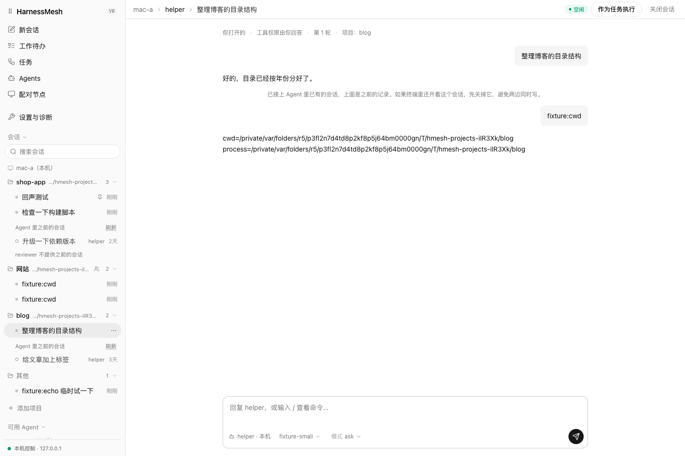
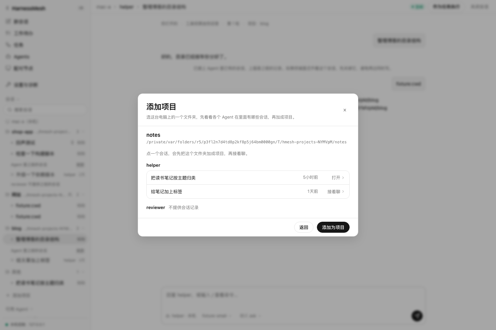
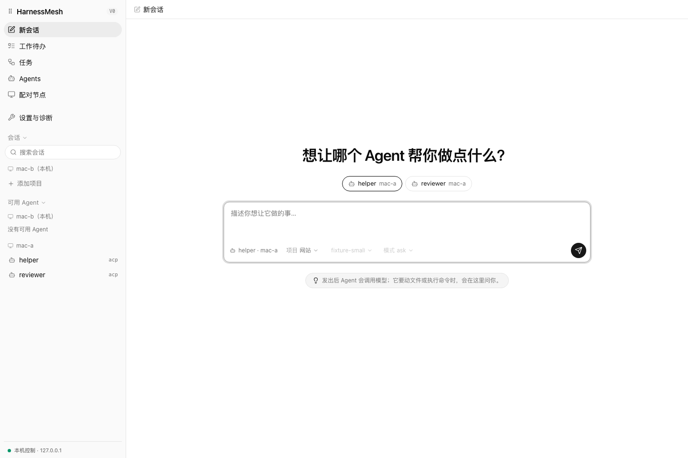

# 本机管理面板

页面内置在 CLI 中，无前端构建、外部字体或云服务依赖。浏览器通过本机桥接进程访问 owner mTLS API，仅监听 127.0.0.1。

## 启动与关闭

```sh
cargo +stable build --locked -p hmesh-cli
./target/debug/hmesh --data-dir "$PWD/.hmesh-v0/tailnet-darwin/node" panel
```

默认连接已有 Daemon。加 `--start-daemon` 可初始化新的空目录，并在没有 Daemon 时启动一个。已有身份、策略和凭据不会被重建。端口默认 38900，支持 `--port 38901` 或自动分配的 `--port 0`；没有对公网、局域网或 Tailnet 监听的选项。Windows 使用 `.exe` 和现有 Node 路径。

## 页面

左侧导航：「新会话」（打开面板就是这一页）、「工作待办」、「任务」（委派任务，以及任务模板和多阶段工作流）、「Agents」、「配对节点」，最后是「设置与诊断」（运行版本、Agent 检查、任务用量与项目预算、会话用量、磁盘与保留、协议兼容矩阵，以及本机发布的服务和转发连接）。「新建委派任务」在「任务」页。

## 安装 ACP 适配器

在运行 Agent 的电脑打开面板，进入「Agents → 接入项目与 Agent」。选择 Codex 或 Claude Code 后，面板会先找本机已经安装的 ACP 命令。缺少时可以点「安装推荐版本」，确认后使用本机 Node.js 和 npm 下载。推荐版本以界面显示为准。

安装目录为节点数据目录下的 `agent-runtimes/<类型>/<版本>`。通过 ACP 握手后，面板自动填入绝对启动路径。进入「绑定项目」，填写 Agent 名称、项目 ID 和执行电脑上的绝对路径。工件、工作目录模式、环境变量名和远端授权预览在「高级设置」里。检查配置后，点击「登记此 Agent」。安装与登记无需发送模型请求。登记完成后，可点击「配置模型服务」检查本机登录，或单独设置 API 地址和 Key。

CLI 可在已初始化的节点数据目录下运行 `hmesh agent install codex` 或 `hmesh agent install claude-code`。命令会输出可用于登记的路径。`hmesh agent detect` 同时查找 PATH 上的命令和当前节点已安装的推荐版本。

## 会话

「会话」页是和 agent 对话的地方：左边是本机的会话和本机在配对电脑上打开的会话，右边是选中会话的实时对话（消息、思考、工具调用、计划、权限请求）。

- 「新会话」：选电脑、agent 和项目，可直接写第一条消息。不选项目时 agent 在它自己的项目目录里工作；发出消息就会调用模型。
- 权限请求：会话是你打开的，就在这里点「允许一次」或「拒绝」；agent 打开的会话按执行端设置自动允许或等那台电脑的主人回答，页面上会写明。
- 「停止本轮」发 ACP `session/cancel`，会话保留；「关闭会话」停掉 agent 进程，不能再继续。
- 别的电脑在 `confirm` 模式下打开的会话显示「等待批准」，在这里批准或拒绝；侧栏「会话」旁的数字是等你处理的会话数。
- agent 通过 `hmesh mcp` 打开的子会话也在列表里，标出调用者和调用链。
- 输入框下面是 agent 报上来的会话设置（模型、模式、思考强度）：新会话发第一条消息前就能选（用的是这个 agent 上次报的选项），会话里两轮之间可以切，切换会记在对话里。只有打开会话的电脑能改。
- 在新会话或已有会话中输入 `/`，可查看当前 Agent 支持的命令、说明和参数提示。继续输入可筛选，方向键或鼠标可选择。首次查看会启动该会话的 Agent，远端要求审批时会先等待批准。查看清单和选择模型都不发送聊天消息。
- Pi 输入 `/model`、OpenCode 输入 `/models` 可选当前会话的模型。选择 `/compact` 后可发送执行，Pi 也接受压缩说明。压缩由该 Agent 在原会话中执行，生成摘要可能使用模型额度。切换 Agent、项目或会话时以新会话的清单为准。
- CLI 用 `hmesh session commands <会话 ID>` 查看原生命令和模型选项，用 `hmesh session command <会话 ID> compact` 执行原生命令。Pi 可附加 `--arguments '保留未完成事项'`。切换模型使用 `hmesh session config <会话 ID> model <选项值>`。
- 开发时，在本机安装好 `pi`、`pi-acp` 和 `opencode` 后，运行 `npm run test:real-agent-commands` 可验证两个真实适配器。脚本使用临时配置和本机模型替身，核对自定义命令、模型切换、原生压缩，以及下一轮收到的摘要。
- 「Agents」页每个本机 agent 有「模型服务」：用它自己的登录、API key 或自定义地址，以及默认模型和额外环境变量。key 只存在这台电脑上，保存后不再显示，只给末 4 位；配对电脑只看到「已配置」。CLI 对应 `hmesh agent service <agent> --mode … --api-key-stdin` 和 `hmesh session config <session> <setting> <value>`；额外变量用 `--env NAME`，值取自这条命令自己的同名环境变量，不出现在命令行和 shell 历史里（`--keep-env NAME` 保留已存的值，`--clear-env` 全部删除）。
- Pi、OpenCode 和 DSH 的自定义地址支持模型列表（每行一个，最多 100 个）。可以填默认模型，也可以用列表第一项。CLI 使用可重复的 `--model NAME` 或 `--clear-models`。OpenCode 的自定义端点经本机 Daemon 转发，进程只收到转发令牌。
- 「测试连接」（CLI 加 `--test`）用弹窗里正在填的内容测试，key 没重新输入就用已存的：先问服务商要模型列表，不花 token，能列出来就可以一键填入「可切换的模型」（合起来超过 100 个时不提供一键填入，需要手动挑）；列不出来才用默认模型发一次很小的请求。有的服务列模型时不检查 key，所以「列出了 N 个模型」只说明地址能连上，key 是否有效要等第一轮对话或小请求才知道。自行登录的连接，以及 Pi、OpenCode 和通用 ACP 的单独 Key，在 Agent 内实际发消息验证。
- 弹窗顶部会说明这个 agent **自己**配好了没有（打开弹窗时检测一次，也可以点「重新检测」；CLI 是 `hmesh agent service <agent> --check`）：比如「检测到 Claude 订阅（max 套餐），you@example.com」「已存的凭据：OpenCode (api)」「4 个服务商、29 个模型」，或者「没检测到它自己的登录」并提示怎么登录。配好了就不用在这里填 key；想让它单独用别的 key 或服务，直接选「单独给它一个 key」或「自定义地址」重新配置，选回「用它自己的登录」就恢复。Agents 页的卡片也会写「用它自己的登录（已配好）」或「单独配置」；配对电脑只看到配没配好，看不到登录方式和账号。
- 「自定义地址」先选网关使用的接口协议。预设只展示提供该协议地址的服务商，也可以手填含端口的基础地址，例如 `http://127.0.0.1:8080/v1`。回环地址指运行 Agent 的那台电脑。CLI 使用 `--protocol openai-chat|anthropic-messages|openai-responses`，配合 `--base-url <地址>` 或 `--preset <id>`。
- 勾选「key 从本机环境变量读取」后只填变量名（CLI `--api-key-env NAME`）：key 不存进 HarnessMesh，启动 agent 时从这台电脑运行 HarnessMesh 的环境里读，选了预设会自动填上常用的变量名。

### 项目和 Agent 已有的会话

- 本机的会话按「电脑 → 项目 → 会话」分组。每个登记 agent 的目录自动是一个项目；「添加项目」可以从各 agent 的历史里勾选出现过的文件夹，也可以直接输入文件夹路径。
- 展开一个项目，除了 HarnessMesh 开的会话，还会列出 agent 自己在这个文件夹里已有的会话（支持 ACP `session/list` 的 agent，如 Claude Code、Codex、OpenCode、Pi）。展开时现读，30 秒内复用；HarnessMesh 不读取、不复制、不改写 agent 自己的会话文件。不支持列出的 agent 显示一行说明。
- 点一条旧会话就接上它：agent 用 `session/load` 回放之前的对话，接上成功后面板把这份记录一次存下来，然后像普通会话一样接着聊。只在第一次接上时保留回放，之后进程重启不会重复；接上失败或中途停止时不存半份，下次接上再完整存。agent 还在启动时发的消息会先存着，接上后显示在历史后面；这时关掉会话或重启 HarnessMesh，消息也会保留。只支持 `session/resume` 的 agent 能接着聊，但不显示之前的记录。**如果终端里还开着同一个会话，先关掉它**，避免两边同时写。
- 本机任意 agent 都能在任意已添加的项目里开新会话；配对电脑的 agent 只能在它的主人共享的项目里开会话（项目菜单里的「共享给配对的电脑」，默认不共享）。共享后，对方的 agent 能按它的工具白名单读写这个文件夹。
- 项目菜单：改名、置顶、上移、下移、隐藏、共享、移除（只限自己添加的；agent 的目录只能隐藏）。会话菜单：改名、置顶、隐藏。改名只改这台电脑上显示的名字，不改 agent 里的标题。侧栏顶部可按标题搜索；底部开关可以显示已隐藏的项目和会话。隐藏的项目不会出现在新会话的项目选择里，共享的项目隐藏后配对电脑也看不到它。
- 旧会话只在本机面板列出，不会发给配对的电脑。







页面用长轮询跟随当前会话（每次最多 10 秒），切换会话或离开页面就停止。

完整访问链接带本次随机令牌，仅供本机 owner。浏览器清除地址栏 fragment，并在当前标签页 sessionStorage 保留访问令牌；新标签页需重新打开完整链接。不要转发或公开记录启动链接。`--json` 输出启动 URL、面板 PID 和本次拥有的 Daemon PID，集成工具应使用私有日志。

顶部关闭按钮或 Ctrl+C 正常关闭面板，只停止它启动的 Daemon，复用的已有 Daemon 保持运行。启动和停止均核对进程身份；端口占用在初始化/启动前报错。旧 Daemon 仍可打开兼容或只读面板，不会因缺少新功能而被替换。异常硬杀或断电不提供相同的正常关闭保证。

## 各 Agent 可选的协议

相同类型的两个 Agent 也可以分别保存自己的 Key、地址和模型。配对电脑上的 Agent 由那台电脑的主人管理。

| Agent | 「单独给它一个 key」的用途 | 「自定义地址」的协议 |
| --- | --- | --- |
| DSH | DeepSeek 官方 API | OpenAI Chat Completions、OpenAI Responses、Anthropic Messages |
| Pi | 选择 DeepSeek、OpenAI 或 Anthropic 的官方模型，填写 `服务商/模型`，如 `deepseek/deepseek-v4-pro` | 同上 |
| OpenCode | OpenCode 官方服务 | 同上 |
| Claude Code | Anthropic | Anthropic Messages |
| Codex | OpenAI | OpenAI Responses |
| 其他 ACP Agent | 按其文档填写它读取 Key 的环境变量名，CLI 使用 `--key-variable NAME` | 地址及格式按该 Agent 自己的配置设置 |

协议由服务商的 API 决定。例如，同一个 DeepSeek 模型可能通过网关提供 Chat Completions，也可能提供 Anthropic Messages。模型名按网关登记的 ID 填写。

Pi 的独立模型配置沿用本机的提示模板、技能、扩展和主题目录，以及相应的启用或排除设置。通过 Pi 软件包安装的资源仍由原安装管理。OpenCode 的官方 Key 模式可留空默认模型，也可以填写 `opencode/<模型 ID>`。

## DeepSeek Harness（DSH）

1. 在执行 Agent 的电脑上安装 Node.js 24.9 或更新版本，运行 `npm install -g @deepseek-ai/dsh@0.2.2-rc.5`。可用 `hmesh agent detect` 检查 HarnessMesh 能否找到 `dsh`。
2. 在面板「Agents → 接入项目与 Agent」选择「DeepSeek Harness (DSH)」，填写项目和工作目录，预览后登记。执行端以 `dsh --profile acp` 启动。旧 headless 登记可用 `hmesh agent update <原 Agent ID> --config <ACP 配置文件>` 保留原 ID。
3. 在 HarnessMesh「Agents → 这个 Agent 的模型服务」选择「单独给它一个 key」连接 DeepSeek 官方服务。使用网关时，选「自定义地址」，填写协议、地址、Key 和网关的模型 ID。选「用它自己的登录」会沿用 DSH 的本机账号和模型设置。[官方模型设置指南](https://github.com/deepseek-ai/deepseek-harness/blob/dsh-v0.2.2-rc.5/docs/user/guide/providers.zh.md)
4. 在「会话 → 新会话」选择刚登记的 Agent。输入 `/` 可查看可用操作，有模型选项时可用面板快捷方式 `/model` 切换。模型和推理强度均取自当前 DSH 会话。`/compact` 不在此版本的官方 ACP 接口中。执行进程重启后，下一轮会通过 `session/resume` 继续已有的 DSH 会话，历史消息由 HarnessMesh 展示。[官方 ACP 协议](https://github.com/deepseek-ai/deepseek-harness/blob/dsh-v0.2.2-rc.5/packages/acp/acp/README.md#protocol-contract)

本地回归使用 `cargo build --locked -p hmesh-cli` 与 `npm run test:real-dsh`。脚本用隔离的 DSH 配置和本机模型服务替身，验证模型切换、取消，以及 Daemon 重启后下一轮是否带上首轮问答。安装好 Pi、OpenCode 和 DSH 后，可运行 `npm run test:provider-protocols` 验证各 Agent 的 Key、真实推理请求格式和回复。

从自定义地址切回「用它自己的登录」时，如果 DSH 原生配置里没有旧会话使用的服务商，可以新开会话使用原生服务。切回之前的自定义配置，可继续原来的会话。

## 运行版本与兼容模式

「设置与诊断」页顶部显示 CLI 版本、运行中的 Daemon 版本、PID、schema 和功能能力；其他页面只在只读、兼容模式或需要升级时显示这块提醒。旧 Daemon 没有报告版本时显示未知，不用本机新 CLI 的版本推断正在运行的版本。面板通过自己的 `/api/runtime` 读取白名单摘要，不向浏览器返回 owner token 或私有配置。

- `full`：支持基础任务工作流、`task-preflight-v1` 和开发工作流。
- `compatible`：支持基础任务工作流和预检，可用任务管理；缺失的开发功能单独停用。
- `read_only`：缺少基础任务工作流或预检能力，保留基本读取和关闭本次面板；提交、审批及其他写操作同时在服务器端拦截。

能力会重新读取，Daemon 被 owner 更换或重启后不沿用旧的写权限判断。暂时失联也进入只读模式，但不据此认定需要升级。已知旧版本会显示手工步骤：先处理未结束任务，用旧版本 CLI 正常停止并备份，检查新运行包，再显式启动同一节点并核对登录自启引用。面板不会执行这些步骤，也不会停止、迁移或升级既有 Daemon。

项目协作使用已有 schema 9，没有新增数据库迁移。要使用项目发现、版本预检和远端 diff，发起端与执行端都需运行支持 `project-collaboration-v1` 的 Daemon。

## 任务工作流

- **新建任务**：选择本机或已信任节点、对本机可见且验证通过的 Agent、所属项目与目标，可选填写待验收的相对工件路径，多个路径用逗号分隔。默认 600 秒 / 16 MiB 输出，可按核心边界调整。输出字节不是 token 或费用预算。先预检再审阅，提交时服务器重新检查；执行端在 `confirm` 模式下需要本机批准，`auto` 模式下可直接开始。开始后可能调用模型并产生费用。
- **审批与执行**：审阅完整请求、目标 Agent、项目、工件和预检结果，再批准或拒绝。面板服务器在批准前重新读取原任务的预检，未通过时不派发批准；旧任务没有工件契约也执行这项检查。支持取消任务、查看 attempt 与执行状态、按 seq 补读事件、归档本机终态事件。
- **原请求恢复**：发送前生成并保留稳定 UUID。丢失确认后冻结原草稿；显式恢复使用本机已持久化的原 envelope，不接受新的目标或限额，不自动换 ID 重试。已有任务保持同一 task/attempt，未到达的原请求仍按原审批要求入队。放弃本地草稿不会取消服务端任务，无法保留草稿时不会发送。
- **工件核验**：成功任务可选择执行端 owner 已授权的相对路径，填写包含 1–16 个字段、最多 8192 字节的预期 JSON。显示字段断言、SHA-256、attempt 和配置摘要。核验失败不改写执行成功，也不调用模型。schema 7 新任务读取完成时快照，历史任务明确标记为当前文件。

执行状态和工件验收状态分开展示：`SUCCEEDED` 仅表示执行成功，仍可能是待验收、核验失败、核验状态未知或未设置工件验收。任务列表可筛选待验收和需处理记录；远端结果注明最近观察时间与缓存身份。打开的详情在执行终态后继续读取后续核验结果，编辑核验表单时保留内容和选择，不用后台刷新覆盖输入。

## 从项目和会话发起任务

打开「新建委派任务」，选择执行电脑、Agent 和项目，再填写任务目标。也可以展开「按项目查找 Agent」比较不同电脑与 Agent 的验证和审批状态。执行限额、Git 版本和工件验收可分别展开。点「预检并审阅」核对目标、限额、版本和审批要求，再确认发送。已登记项目的路径和凭据保留在执行端。

在你打开的会话中点「作为任务执行」，检查预填的任务目标并编辑验收条件。任务沿用该会话的电脑、Agent 和项目，保存任务 ID 与会话的关联。可声明工件并冻结一个 JSON 子集断言，执行完成后由面板从原会话查看报告、diff 和核验结果。Agent 执行报告和工件核验分开显示。

对于 Git 项目，先用「检查执行条件」对比发起端与执行端的分支、完整提交和工作区状态。可以选择执行端当前检出，或让执行端在独立工作目录检出一个完整提交 ID。指定提交必须已存在于执行端仓库。新任务记录选定版本，执行时再核对，并展示实际提交。独立目录生成的 diff 可由原发起端查看。已有的离线 patch 审阅和应用流程适用于执行端。

「工作待办」集中显示本机任务和会话审批、工具授权、远端等待、执行进度和待验收结果。远端记录显示最后一次确认时间。连接中断保留已确认状态，恢复连接后只读刷新原记录。未确认提交可明确选择「检查原请求」，使用原 UUID 恢复。

## 执行前预检与工件契约

预检检查当前 Agent 支持/验证、项目和引用有效性、来源信任、任务权限、审批要求以及所需工件声明，并展示通过项、阻塞项、配置摘要和观察时间。预检不创建任务、不预留请求、不修改授权，也不调用模型。修改表单会使原预检失效；确认期间配置变化仍可能阻止提交或审批。

可选 `expected_artifacts` 是对任务的限制，要求指定路径已在执行端 owner 的 `artifact_paths` 中。它不会新增文件授权；执行端须保留原声明并显式补充需要的路径。协议要求 1–16 个不重复的可移植相对路径，拒绝绝对路径、越界和平台专用写法。面板未选择工件时发送空选择，桥接层转为省略契约；核心协议中的显式空契约仍无效。

带契约的任务在提交、批准和执行时检查声明，执行器还检查该 attempt 实际捕获的配置。完成快照使用该执行配置，之后追加声明不能给旧任务补造快照。带 JSON 核验的任务模板会把相应工件路径冻结为任务的 `expected_artifacts`。

原发起节点和执行端都需要支持 `task-preflight-v1`。旧远端缺少接口、失联或检查无法完成时显示未检/不可用，不当作通过。预检明确阻断时不会提交任务，草稿仍可编辑；实际提交结果不确定时继续保留原 UUID 和恢复入口，不换 ID 重试。

CLI 可重复使用 `--artifact` 声明契约；有契约的发送会先预检，失败时不提交：

```sh
hmesh --data-dir NODE task send AGENT_UUID --peer PEER_UUID --project PROJECT \
  --artifact out/health.json --artifact out/result.json --prompt '具体任务'
hmesh --data-dir NODE task preflight TASK_UUID
```

`task preflight TASK_UUID` 只读检查原任务及当前执行条件，不重新提交任务或调用模型。

## 审批待办与跨机交接

导航上「任务」旁的数字、会话页以外各页顶部的提示和页面标题提示本机待审批任务，待办只统计本机执行记录。任务详情区分本机审批与等待指定执行端审批；复制的固定任务交接说明包含节点、任务、Agent、项目、工件、限额和执行端本机命令，不包含面板访问链接或凭据。执行端 owner 仍须审阅并在自己的电脑上决定是否批准；交接不授权远程批准，也不修改策略。

发出任务列表来自持久化的最近观察缓存，标有“发出 · 缓存”；详情实时查询执行端。schema 6 起保存最近一次成功读取的观察时间，升级前没有时间的旧缓存保持未知。失联会显示错误码、trace 和可用缓存，历史成功不代表远端当前在线。

一次读取一页事件，补读保留 seq 游标；单次打开最多显示 2000 条。更大回放使用 `hmesh task events/watch`。归档是同库逻辑归档，不删除历史或缩减文件大小。

## 节点、Agent 与服务

「配对节点」页分开显示配对申请和已配对的电脑。点「配对新电脑」后，可在「粘贴对方的码」发出申请，或在「本机配对码」复制自己的码给对方。CLI 也可以用 `hmesh pair show` 读取 `pair_code`。发起方的弹窗会显示 6 位校验码。对方在「配对节点」或「工作待办」打开申请，核对并输入校验码后批准。发起方自动更新配对结果。等待中的申请可以取消，被拒绝或过期的申请可以重发。已配对的电脑下可查看连接、信任状态，以及对本机可见或可运行的 Agent。每张已配对电脑的卡片上有一行「地址」：对方告诉本机的地址（名片地址和主机名），以及本机手动填的地址（标「手动」）。点「改地址」在卡片里直接改：多个地址用空格隔开，写成 `主机名:端口` 或 `IP:端口`，留空保存就清除；手动地址只保存在这台电脑上，前面的地址连不上时再试。

局域网直连（`hmesh setup --network direct`）时，打开配对弹窗会启用 10 分钟的配对窗口。倒计时结束后可以手动续开。窗口开着时，接受连入的电脑显示 6 位口令和剩余次数；直连电脑（包括仅 MCP 模式的）的弹窗顶部列出「附近的电脑」，每 3 秒刷新：选中一台，点「用口令配对」，输入它屏幕上的口令就配好，不用批准。用过或错满 3 次的口令会注明，点「换一个口令」换新的，配对码一直能用。弹窗开着时每 3 秒和 daemon 同步一次，关上就停。仅 MCP 模式（`hmesh setup --mcp-only`）的电脑从本机粘贴对方的配对码发起申请，在对方的节点列表标为「只调用」。

本机 Agent 可退役和恢复。恢复后通过 CLI 显式重新验证。「设置与诊断」页下半部分显示租约、受管进程、HTTP 健康、连接和隧道，支持重启受管服务和撤销访问。发布服务和建隧道用 CLI。

「设置与诊断」里的「会话用量」只统计在这台电脑上运行的 agent 的会话，只显示 agent 自己报的数：累计费用和上下文占用取它最近一次 ACP `usage_update`，token 取最近一次报了数的那一轮 prompt 返回里的 `usage`（ACP 里还是不稳定字段）。一轮结束时只要 agent 报了新数，HarnessMesh 就记一个 `usage` 会话事件，没报新数的轮次不记；agent 重新启动后先沿用上次的上下文和费用，直到它报新的。不自己相加或估价；不报的 agent 显示「—」，没上报的会话只计入总数。委派任务的用量仍在「任务用量与项目预算」里，两者分开。

Agent 登记可通过接入向导完成，凭据只接受本机引用并提供精确授权预览。模型验证、策略修改、撤销配对、改对端访问模式与服务发布保留在 CLI。面板没有任意命令、任意 API 代理或配置文件编辑入口。

## 访问与升级边界

owner token、私钥与模型凭据留在 Rust 进程，不发送到浏览器。每次启动生成独立浏览器令牌；API 要求精确 Host，写请求还要求同源 Origin。生命周期操作只接受空 JSON；任务/核验使用拒绝未知字段的类型化请求。页面无跨站 CORS 放行，禁止 frame 嵌入，响应不缓存，远端文本只通过 textContent 渲染。服务只返回摘要，不发送进程环境、参数或原始诊断。

远端工件核验只允许原任务发起节点，要求当前信任与该项目/Agent 的 task.submit grant 有效，并继续受执行端 artifact_paths 约束。返回路径列表、hash 和断言，不返回文件正文；不会扩大文件 allowlist。撤销授权后拒绝核验。支持核验转发接口的版本可由原发起端经正常配对 mTLS 请求；缺少接口的旧版仍由执行端 owner 本机核验，再读取已发布结果。

升级 schema 7 前用离线备份命令保存节点身份、配置和数据库；旧二进制拒绝打开新版数据库。面板不会偷偷迁移旧运行实例。它是本机 owner 的部分管理入口，不是多用户系统或 OS 用户隔离。

## 回归与运行包

普通 `cargo test --locked --workspace` 使用真实 HTTP/mTLS 和临时数据库，验证鉴权、原请求去重、工件边界、迁移、进程归属及旧 Daemon 保留，也覆盖缺少工件声明时不提交、不批准和只读模式的服务器写拦截。没有真实模型调用。

```sh
cargo +stable build --locked -p hmesh-cli -p hmesh-fixture
npm ci --ignore-scripts
npx playwright install chromium
npm run test:panel
npm run test:project-work
```

Playwright 版本由 package-lock 固定，仅为开发回归依赖。可用 HMESH_PLAYWRIGHT_MODULE 指定已安装模块，用 HMESH_CHROME 指定本机 Chromium。两个独立临时 Node 与明确标识的 fixture 验证新建、审批、丢失确认、恢复不重复 attempt、核验通过/失败、Agent 生命周期、XSS、手机布局和关闭操作；这不代替新的真实跨机模型验收。CI 在 Linux 自动执行浏览器回归。

原生 Mac/Windows release 运行包及实际解压回归见 [打包与启动](runtime-packages.md)。运行包无需 Rust/npm，不带项目、模型凭据、Harness 或 Tailscale。初版面板的历史基线见 [原验收记录](evidence/latest-local-panel.json)。

2026-11-01 开发回归：79 项 Rust、14 项 Node 协议检查、20 项浏览器流程、9 项 Mac 实际运行包检查通过，fmt/Clippy 通过。三项既有本机 mTLS/修复替身/防重放流程复测通过。见 [本地脱敏记录](evidence/latest-panel-workflow.json)，跨平台 CI 与运行包结果以对应 PR/workflow 为准。

0.0.1 的快照、独立工作目录 diff、队列等待原因与项目/Agent 接入向导见 [本机可靠性与接入](local-reliability.md)。

2026-11-23 Mac 本机回归：本轮预检、结果更新、审批待办与旧 Daemon 兼容完成；Rust 工作区、fmt、Clippy 通过，三套浏览器回归共 50 项、持久工作流 11 项通过。均使用临时 loopback 节点和明确的 fixture，真实模型调用为 0；Windows 操作确认按本轮范围暂不进行。见[脱敏验收记录](evidence/latest-delegation-ux.json)。
