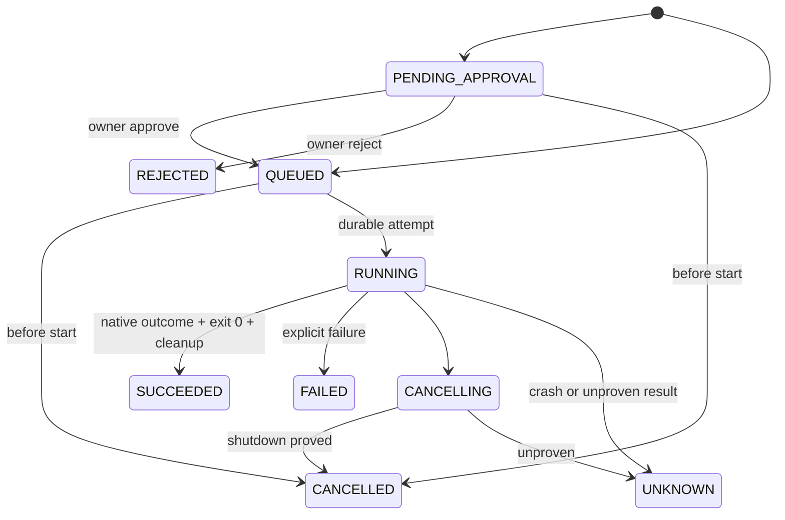

# 当前实际协议

本文件描述当前 Rust 实现：V0 任务核心、SSH 检查点、原生 MCP 子集及受管 HTTP 服务。核心类型在 `crates/hmesh-core/src/lib.rs` 和 `managed.rs`；节点 endpoint 只接受回环地址的 TLS 1.3，跨机复用受控 SSH 路径。JSON 配置未知字段被拒绝。完整 V0.1/V0.2 的后续接口仍以真实实现和验收为准。

## 请求和身份

`POST /hmesh/v1/tasks` 使用 `Envelope<TaskSubmit>`：

```json
{
  "version": "hmesh/1",
  "request_id": "00000000-0000-4000-8000-000000000001",
  "sender_node_id": "00000000-0000-4000-8000-000000000002",
  "timestamp": 1793145600,
  "operation": "task.submit",
  "trace_id": "00000000-0000-4000-8000-000000000003",
  "payload": {
    "task_id": "00000000-0000-4000-8000-000000000004",
    "target_agent_id": "00000000-0000-4000-8000-000000000005",
    "project_id": "demo",
    "goal": "在已登记项目中创建测试工件",
    "inputs": [],
    "limits": {"timeout_seconds": 600, "max_output_bytes": 1048576},
    "requires_approval": true
  }
}
```

sender 必须等于 TLS 客户端证书在当前信任库映射的 Node。请求不能指定 cwd、可执行文件、任意 argv、环境或证书；这些全部由执行端 owner 登记。时间采用 Unix 秒。时间戳不充当执行去重或身份凭据。

TaskSubmit 的 goal 上限 65536 UTF-8 字节；超时 1–1800 秒；stdout 默认额度 1 MiB，代码生成任务可显式用 `task send --max-output-bytes` 申请至多 32 MiB，超过仍终止。原生 JSONL 消息与内部 Mesh 事件采用不同边界：Pi 单条原生消息最多 4 MiB，DSH/OpenCode 最多 1 MiB，并且不超过该任务的累计 stdout 额度。超过原生消息或累计额度返回 RATE_LIMITED，畸形/不完整 JSONL 仍明确失败。输入目前只允许有限数量的 text 值。HTTP 请求/响应上限保持 1 MiB。OpenCode 在 Windows 的 prompt 参数另有限制，超出已验证 argv 长度时明确失败。

原生消息经过 Adapter 提取必要字段；工具参数、工具结果与消息快照不进入事件库。正文先完成跨事件凭据脱敏，再按 UTF-8 字符边界拆成每段至多 8 KiB 的 text_delta；JSON 转义后的内部 payload 仍须不超过 64 KiB。正文不再因诊断摘要的 4 KiB 截断而丢失，工具名称和 stderr 摘要仍有独立长度限制。事件读取每页至多 1000 条且序列化 JSON 数组至多 512 KiB，通过最后 seq 继续读取，避免大正文冲破 HTTP 响应边界。

运行清理后保存 output_summary，包含累计 stdout 字节、所选额度、最大完整原生消息大小和完整消息数量；不保存原生消息内容。正常成功仍要求原生完成条件、退出 0 与进程清理成立。详见 ADR 0003。

## 路由

| 边界 | 路由 | 授权 |
|---|---|---|
| 配对引导 | GET `/hmesh/v1/hello`, GET `/hmesh/v1/pair/challenge`, POST `/hmesh/v1/pair/requests` | 匿名 TLS 客户端可请求；仍须验证目标证书 pin，受速率限制 |
| 节点/Agent | GET `/hmesh/v1/node`, GET `/hmesh/v1/agents` | 当前信任的 mTLS 身份；Agent 列表受项目/Agent grant 过滤 |
| 入站提交 | POST `/hmesh/v1/tasks` | 当前信任、项目/Agent 的 task.submit grant、可运行验证和本机审批 |
| 任务读取 | GET `/hmesh/v1/tasks/{id}`, `/events?after=N`, `/verification` | 原始发起 Node 或执行端 owner |
| 任务取消 | POST `/hmesh/v1/tasks/{id}/cancel` | 同上；必须证实停止才确认取消 |
| 服务卡 | GET `/hmesh/v1/services`, `/{id}` | 当前信任的 mTLS 身份及服务 owner 的精确 peer 白名单 |
| HTTP 服务调用 | POST `/hmesh/v1/services/{id}/http` | 同上，调用前及释放缓冲响应前重查租约/授权 |
| 固定服务重启 | POST `/hmesh/v1/services/{id}/restart` | 额外 allowed_restart_peer_ids；不接受启动参数或 cwd |
| owner API | `/local/*` | 自己的证书、私有 Bearer token、回环来源三项同时成立 |

owner API 包含配对批准/撤销、登记/验证 Agent、更新策略、任务批准/拒绝、artifact grant、确定性验证、审计与 Daemon 停止。CLI 使用选定 data-dir 的身份连接自己的 API；它不会把 owner token 发送给 peer。

受管资源 owner 路由包括 GET/POST `/local/services`、`/local/tunnels`、`/local/connections`，指定 id 的 revoke/restart，以及 `/local/services/remote/{peer}`。联调为 GET/POST `/local/integrations`、GET `/{id}`、POST `/{id}/cancel`。HTTP 数据包为 method/path/content_type/body_base64 和 status/content_type/body_base64，每边正文最多 256 KiB；连接是本机回环 HTTP 到 peer mTLS RPC 的受控桥接，不是通用 TCP。参数、授权和恢复规则见 [受管服务说明](managed-services.md)。

`hmesh-mcp` 使用同一本机认证路径，但只暴露五个固定的、绑定 RUNNING parent 的工具；owner scope 再限制目标、子任务次数与限额。子任务稳定 UUID、完整请求与 parent 绑定保存到 schema 3 的 tool_submissions 表。失联不自动释放额度，不把重试解释为新授权。MCP 对话不暴露 approve、policy 或通用 owner API 调用，详见 `docs/mcp.md`。

## 持久化和状态

SQLite 使用 WAL、完整同步和 schema migration。入站以 `(sender_node_id, request_id)` 原子去重；相同 payload 返回已有 task，冲突 payload 拒绝。claim、attempt 和状态事件在一个事务中建立；终态不会重新入队。发起端也保存原始 envelope 和执行 Node 的路由，所以重启后仍可以查询远端任务。

schema 4 新增 managed_records 保存服务、SSH、连接租约和 IntegrationRun，不改写 schema 3 的历史任务/委派。repair UUID 在发送前持久化，失联不换 UUID 重跑；已终止联调通过数据库条件更新阻止迟到 worker 覆盖。Daemon 重启将旧资源 disabled、未结束的联调 needs_input；旧配置/报告保留查询，操作不自动恢复。



默认并发 1，排队上限 20。离开队列时再次核对授权，撤销的任务不会启动进程。重启发现 RUNNING/CANCELLING/WAITING_INPUT 均归为 UNKNOWN，保留 attempt，禁止自动重跑。等待交互/工具审批的非交互运行返回 `FAILED_NEEDS_INPUT`；不替用户回答批准。

事件为持久化序列 `{task_id, seq, event_id, attempt_id, event_type, payload, created_at}`。GET events 每页最多 1000 条；客户端推进到最后的 seq，重复查询补读。CLI watch 使用相同游标轮询；V0 未实现 SSE。摘要可能含 text_delta、工具名称/阶段、artifact 名称/hash/大小；不会分享原始工具参数和工具输出。

成功判断分别为：Pi 的最终 assistant stop、agent_settled 和退出 0；DSH 的 final、没有失败状态和退出 0；OpenCode 的最终 stop、无 error 和退出 0。Pi prompt ack/agent_end、DSH final、OpenCode tool-calls 均不能单独证明成功。成功还需受控进程清理完成。

artifact 只读取 owner 授权的项目内相对路径，canonicalize 后检查未越界，文件上限 10 MiB；返回 SHA-256 和大小。确定性 JSON 子集断言单独记录到 verifications 和事件中；断言失败不篡改原来的 Harness SUCCEEDED。V0 没有任意文件下载接口。

错误为 `{"error":{"code":"PERMISSION_DENIED","message":"…","retryable":false,"trace_id":"…"}}`。CLI 错误写 stderr；退出码 2=输入/版本，3=认证/授权，4=连接，5=执行/验证失败，6=结果未知。`task show` 的读取成功可返回 0，即使所读任务失败；`task watch` 和 `task verify` 会按最终执行/验证结果返回相应退出码。
