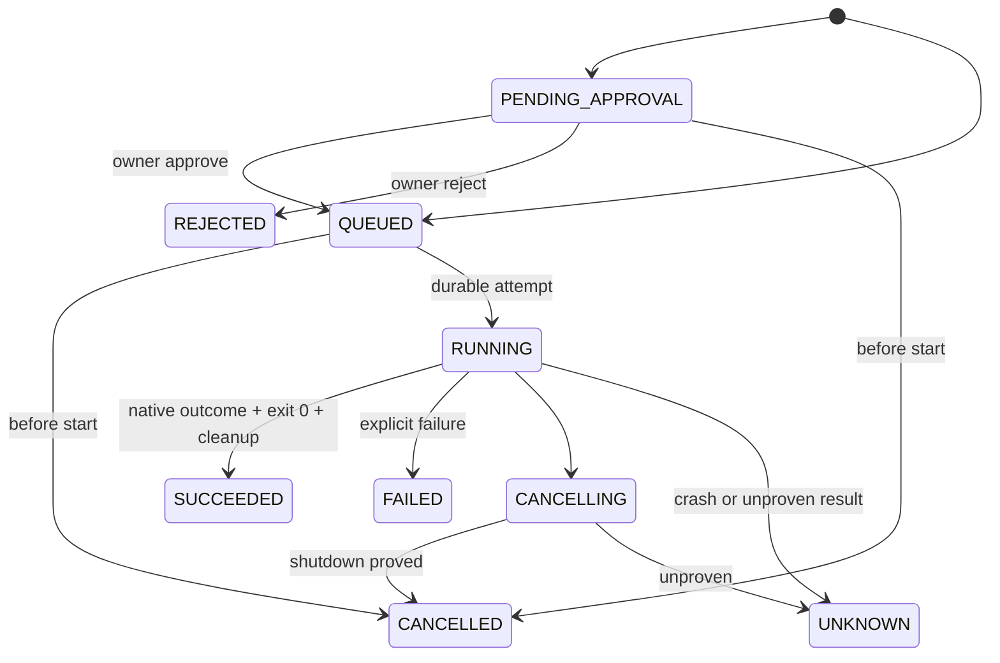

# 当前实际协议

本文件描述当前 Rust 实现：V0 任务核心、SSH 检查点、原生 MCP 子集及受管 HTTP 服务。默认仅回环；显式 `network = "tailscale"` 允许确切 Tailnet 字面 IP 的 TLS 1.3/mTLS 直连，owner 保留独立回环监听。JSON 配置未知字段被拒绝。见 [Tailnet 配置](quickstart-tailnet.md)；物理两机、真实模型和完整 V0.1/V0.2 的验收范围以对应证据记录为准。

## 请求和身份

`POST /hmesh/v1/tasks` 使用 `Envelope<TaskSubmit>`：

```json
{
  "version": "hmesh/1",
  "request_id": "00000000-0000-4000-8000-000000000001",
  "sender_node_id": "00000000-0000-4000-8000-000000000002",
  "timestamp": 1793145600,
  "operation": "task.submit",
  "trace_id": "00000000-0000-4000-8000-000000000003",
  "payload": {
    "task_id": "00000000-0000-4000-8000-000000000004",
    "target_agent_id": "00000000-0000-4000-8000-000000000005",
    "project_id": "demo",
    "goal": "在已登记项目中创建测试工件",
    "inputs": [],
    "limits": {"timeout_seconds": 600, "max_output_bytes": 1048576},
    "requires_approval": true
  }
}
```

sender 必须等于 TLS 客户端证书在当前信任库映射的 Node。请求不能指定 cwd、可执行文件、任意 argv、环境或证书；这些全部由执行端 owner 登记。时间采用 Unix 秒。时间戳不充当执行去重或身份凭据。

TaskSubmit 的 goal 上限 65536 UTF-8 字节；超时 1–1800 秒；stdout 默认额度 1 MiB，代码生成任务可显式用 `task send --max-output-bytes` 申请至多 32 MiB，超过仍终止。原生 JSONL 消息与内部 Mesh 事件采用不同边界：Pi 单条原生消息最多 4 MiB，DSH/OpenCode 最多 1 MiB，并且不超过该任务的累计 stdout 额度。超过原生消息或累计额度返回 RATE_LIMITED，畸形/不完整 JSONL 仍明确失败。输入目前只允许有限数量的 text 值。HTTP 请求/响应上限保持 1 MiB。OpenCode 在 Windows 的 prompt 参数另有限制，超出已验证 argv 长度时明确失败。

TaskSubmit 可带 `expected_artifacts: ["out/health.json"]`，要求 1–16 个不重复的可移植相对路径；绝对路径、traversal、反斜杠、冒号、控制字符等被拒绝。它是现有工件声明的子集限制，不是 grant，也不扩充执行端 `artifact_paths`。字段缺省为 None 并省略序列化，旧的无契约任务保持原有 JSON 形式；显式空列表无效。已有 `expected_tools` 同样只限制，不授予工具。模板含 `verification` 时，将该工件路径冻结进创建的任务。

CLI `task send --artifact RELATIVE_PATH` 可重复指定路径；有契约时先预检再提交。`task preflight TASK_UUID` 只读检查原任务，不发送新的任务。

原生消息经过 Adapter 提取必要字段；工具参数、工具结果与消息快照不进入事件库。正文先完成跨事件凭据脱敏，再按 UTF-8 字符边界拆成每段至多 8 KiB 的 text_delta；JSON 转义后的内部 payload 仍须不超过 64 KiB。正文不再因诊断摘要的 4 KiB 截断而丢失，工具名称和 stderr 摘要仍有独立长度限制。事件读取每页至多 1000 条且序列化 JSON 数组至多 512 KiB，通过最后 seq 继续读取，避免大正文冲破 HTTP 响应边界。

运行清理后保存 output_summary，包含累计 stdout 字节、所选额度、最大完整原生消息大小和完整消息数量；不保存原生消息内容。正常成功仍要求原生完成条件、退出 0 与进程清理成立。详见 ADR 0003。

## 路由

| 边界 | 路由 | 授权 |
|---|---|---|
| 配对引导 | GET `/hmesh/v1/hello`, GET `/hmesh/v1/pair/challenge`, POST `/hmesh/v1/pair/requests` | 匿名 TLS 客户端可请求；仍须验证目标证书 pin，受速率限制 |
| 节点/Agent | GET `/hmesh/v1/node`, GET `/hmesh/v1/agents` | 当前信任的 mTLS 身份；Agent 列表受项目/Agent grant 过滤 |
| Agent 类型说明 | GET `/hmesh/v1/agents/kinds` | 当前配对的 mTLS 身份；返回 `[{agent_id,kind,label}]`，只列 agent 目录里后来加的类型（卡片的 `harness` 写的是它所属的原有类型，新类型一律记作 `acp`，老版本才读得懂）。今天的 5 种 agent 不需要，返回空列表。老版本返回 404，调用方当作没有；结构不拒绝未知字段 |
| 共享项目 | GET `/hmesh/v1/projects` | 当前配对的 mTLS 身份；只返回 owner 标为共享且没有隐藏的项目 `{project_id,name}`，不含路径；隐藏只是不再列出，取消共享才会拒绝。老版本返回 404，调用方当作没有共享项目；面板和 MCP 只会选对方列出的共享项目，所以只对新版本电脑带 `project_id`；直接调用 owner API 给老版本电脑带了它，老版本会因为不认识字段而拒绝 |
| 入站提交 | POST `/hmesh/v1/tasks` | 当前信任、项目/Agent 的 task.submit grant、可运行验证和本机审批 |
| 执行条件预检 | POST `/hmesh/v1/tasks/preflight` | 当前可信 mTLS 身份；须有当前项目/Agent 的 agent.read 或 task.submit grant，只有 agent.read 不代表可提交任务 |
| 任务读取 | GET `/hmesh/v1/tasks/{id}`, `/events?after=N`, `/verification` | 原始发起 Node 或执行端 owner |
| 原任务预检 | GET `/hmesh/v1/tasks/{id}/preflight` | 任务读取权限及当前项目/Agent 授权检查 |
| 工件核验 | GET `/hmesh/v1/tasks/{id}/artifacts`, POST `/hmesh/v1/tasks/{id}/verify` | 原始发起 Node，当前信任、task.submit grant 和执行端 artifact_paths；owner 使用本机 API |
| 任务取消 | POST `/hmesh/v1/tasks/{id}/cancel` | 同上；必须证实停止才确认取消 |
| 服务卡 | GET `/hmesh/v1/services`, `/{id}` | 当前信任的 mTLS 身份及服务 owner 的精确 peer 白名单 |
| HTTP 服务调用 | POST `/hmesh/v1/services/{id}/http` | 同上，调用前及释放缓冲响应前重查租约/授权 |
| 固定服务重启 | POST `/hmesh/v1/services/{id}/restart` | 额外 allowed_restart_peer_ids；不接受启动参数或 cwd |
| owner API | `/local/*` | 自己的证书、私有 Bearer token、回环来源三项同时成立 |

owner API 包含配对批准/撤销、登记/验证 Agent、更新策略、任务批准/拒绝、artifact grant、确定性验证、审计与 Daemon 停止。CLI 使用选定 data-dir 的身份连接自己的 API；它不会把 owner token 发送给 peer。

### 只读预检

owner POST `/local/tasks/preflight` 接受 `{peer_id,request_id,task}`，由本机检查或转发到选定 peer 的 POST `/hmesh/v1/tasks/preflight`。远端请求仍使用 `Envelope<TaskSubmit>`，operation 为 `task.preflight`。GET `/local/tasks/{id}/preflight` 检查已保存的原任务，必要时经原配对路由转发，不接受替换目标或正文。

报告为 `{ready,agent_id,project_id,requires_approval,configuration_sha256,checks,observed_at}`；每项 check 只含稳定 `code`、`passed` 和可选的请求字段/相对工件路径 `field`。检查覆盖当前信任、任务权限、项目、Agent 验证/兼容性、引用有效性、工具限制和工件声明，不返回配置全文或凭据。无当前相关 grant 的 peer 不能探测 Agent 是否存在。报告不预留请求或写入任务记录，不修改策略、授权或配置，不启动 Harness 或调用模型。

配置摘要和时间属于本次观察，不锁定之后的整份 Agent 配置。带契约的任务在提交、批准和执行时重新检查工件声明；执行器另外核对本次 attempt 实际捕获的执行配置，再使用该配置采集完成快照。权限或声明不再满足契约时会阻止继续执行，之后增加路径不能给旧快照补造文件。

能力通过 owner status 的 `api_features` 中 `task-preflight-v1` 声明。新版原发起端和执行端才能完成跨机预检；旧远端缺接口或暂不可达时报告 `ready=false` / 预检不可用，不能视为通过。此可选协议扩展保持数据库 schema 8，没有新增 migration；旧版无字段任务的序列化不变。

### 面板版本与交接

浏览器的 GET `/api/runtime` 是本机面板桥接接口，只返回 CLI 版本/schema、Daemon 版本/PID/schema/网络/已知能力和手工升级说明。Daemon 版本未报告时保持未知；不会用 CLI 版本推测。缺少基础任务工作流或预检的旧 Daemon 可只读观察；服务器拒绝除关闭本次面板以外的写操作，开发能力单独判定。能力会重新读取；失联进入只读但不推断必须升级。面板不执行备份、迁移或重启。

审批待办和固定任务交接说明只引用任务身份及执行端本机操作，不共享 owner 访问链接、token 或远程批准权。执行成功和工件验收分开呈现；终态后的核验记录继续观察，编辑中的核验表单保留输入。面板的预检、兼容模式与待办流程见 [本机面板](local-panel.md)。

受管资源 owner 路由包括 GET/POST `/local/services`、`/local/tunnels`、`/local/connections`，指定 id 的 revoke/restart，以及 `/local/services/remote/{peer}`。联调为 GET/POST `/local/integrations`、GET `/{id}`、POST `/{id}/cancel`。HTTP 数据包为 method/path/content_type/body_base64 和 status/content_type/body_base64，每边正文最多 256 KiB；连接是本机回环 HTTP 到 peer mTLS RPC 的受控桥接，不是通用 TCP。参数、授权和恢复规则见 [受管服务说明](managed-services.md)。

`hmesh-mcp` 使用同一本机认证路径，但只暴露五个固定的、绑定 RUNNING parent 的工具；owner scope 再限制目标、子任务次数与限额。子任务稳定 UUID、完整请求与 parent 绑定保存到 schema 3 的 tool_submissions 表。失联不自动释放额度，不把重试解释为新授权。MCP 对话不暴露 approve、policy 或通用 owner API 调用，详见 `docs/mcp.md`。

## 持久化和状态

SQLite 使用 WAL、完整同步和 schema migration。入站以 `(sender_node_id, request_id)` 原子去重；相同 payload 返回已有 task，冲突 payload 拒绝。claim、attempt 和状态事件在一个事务中建立；终态不会重新入队。发起端也保存原始 envelope 和执行 Node 的路由，所以重启后仍可以查询远端任务。

schema 4 新增 managed_records 保存服务、SSH、连接租约和 IntegrationRun，不改写 schema 3 的历史任务/委派。repair UUID 在发送前持久化，失联不换 UUID 重跑；已终止联调通过数据库条件更新阻止迟到 worker 覆盖。Daemon 重启将旧资源 disabled、未结束的联调 needs_input；旧配置/报告保留查询，操作不自动恢复。



默认并发 1，排队上限 20。离开队列时再次核对授权，撤销的任务不会启动进程。重启发现 RUNNING/CANCELLING/WAITING_INPUT 均归为 UNKNOWN，保留 attempt，禁止自动重跑。等待交互/工具审批的非交互运行返回 `FAILED_NEEDS_INPUT`；不替用户回答批准。

事件为持久化序列 `{task_id, seq, event_id, attempt_id, event_type, payload, created_at}`。GET events 每页最多 1000 条；客户端推进到最后的 seq，重复查询补读。CLI watch 使用相同游标轮询；V0 未实现 SSE。摘要可能含 text_delta、工具名称/阶段、artifact 名称/hash/大小；不会分享原始工具参数和工具输出。

成功判断分别为：Pi 的最终 assistant stop、agent_settled 和退出 0；DSH 的 final、没有失败状态和退出 0；OpenCode 的最终 stop、无 error 和退出 0。Pi prompt ack/agent_end、DSH final、OpenCode tool-calls 均不能单独证明成功。成功还需受控进程清理完成。

artifact 只读取 owner 授权的项目内相对路径，canonicalize 后检查未越界，文件上限 10 MiB；返回 SHA-256 和大小。确定性 JSON 子集断言单独记录到 verifications 和事件中；断言失败不篡改原来的 Harness SUCCEEDED。V0 没有任意文件下载接口。

错误为 `{"error":{"code":"PERMISSION_DENIED","message":"…","retryable":false,"trace_id":"…"}}`。CLI 错误写 stderr；退出码 2=输入/版本，3=认证/授权，4=连接，5=执行/验证失败，6=结果未知。`task show` 的读取成功可返回 0，即使所读任务失败；`task watch` 和 `task verify` 会按最终执行/验证结果返回相应退出码。
