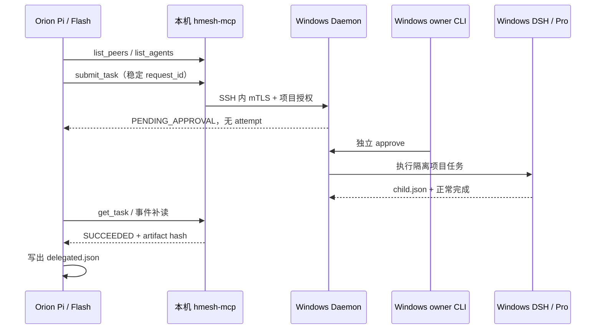

# SSH 双向、断线恢复与 Pi 原生 MCP 验收

2026-10-29 已完成两个检查点：现有 SSH 上的两个方向真实委派，以及一条由真实 Harness 工具调用发起的远端任务。

| 任务 | 真实运行 | 结果 |
|---|---|---|
| `3f090707-fcd3-46da-8f8e-7bd0162387dd` | Windows CLI → Orion Pi 1.4.0 / DeepSeek V4 Flash | SUCCEEDED；forward.json 内容/hash 与独立断言通过 |
| `35c153a8-07e8-4b8d-88cf-8716f5212e72` | Orion CLI → Windows DSH 0.2.0-rc.2 / DeepSeek V4 Pro | SUCCEEDED；执行中断开隧道、正常停止并重启发起端后恢复查询 |
| `6b268118-6f6c-4b24-99cd-89248653b523` | Orion Pi 原生 MCP 父任务 | SUCCEEDED；真实调用四个 Mesh 工具 |
| `15536b80-bf73-44fc-bb8c-e51a828a51fc` | Pi 通过 MCP 委派 Windows DSH 子任务 | 独立批准后 SUCCEEDED；文件与父任务回传 hash 一致 |

## 断线与去重

先在 Windows 观察反向 DSH 为 RUNNING，记录事件游标 3，然后只关闭本次 Mesh SSH tunnel，并正常停止 Orion 发起端 Daemon。Windows 执行端继续运行。记录的停止时间为 UTC 11:41:07.430，Windows 在 UTC 11:41:12 写入成功终态，执行 attempt 保持 `42e0b2b0-3926-4761-8743-cd40991afd7b`。

随后使用原 Node 身份、数据库和端口启动 Orion，重建专用 Mesh tunnel。原发起端重新观察到 SUCCEEDED，补读 10 条后续事件；两端完整 seq 序列一致。再次发送完全相同的 request_id 和任务正文，task/attempt 不变、没有增加运行事件、文件 SHA-256 不变。最后独立 JSON 断言通过。

这是 SSH 中断与**发起端正常停止/重启**的证据，不把它视为执行端硬崩溃、所有 SSH 网络故障或原生 abort 的完整验收。执行端不确定结果仍遵守 UNKNOWN、不自动重跑的原规则。

## 原生 MCP 委派

实际工具名为 `mcp__harnessmesh__mesh_list_peers`、`mcp__harnessmesh__mesh_list_agents`、`mcp__harnessmesh__mesh_submit_task`、`mcp__harnessmesh__mesh_get_task`。SQLite 中持久化了 parent→child 绑定；测试 runner 只负责独立审批和验收，子任务提交来自 Pi 原生 MCP 调用。工具入口没有 approve 或 policy 操作。

父任务回传的 child_task_id、child_status、nonce、child_sha256 与 Windows 实际文件对应。两端 owner API 又分别对 forward 和 child JSON 执行了独立断言。实现与配置见 [MCP 使用说明](mcp.md)。

## 保留的测试偏差

- 首条正向任务 `603c1ca9-3c28-447f-b4a9-62681f0dc1d0` 与反向故障测试同时运行；正常停止 Orion Daemon 时它被取消，状态保留 CANCELLED。检查终态后另建 request_id 和 nonce，独立完成表中的正向任务。脚本现要求正向先通过再开始反向测试。
- 反向任务要求 `out/reverse.json`，DSH 实际写在授权项目根目录 `reverse.json`。原始 not_verified 事件保留，runner 没有搬动或改写文件；owner 显式授权该实际相对路径后，重新执行确定性 JSON/hash 核验并通过。后续脚本明确使用项目根目录文件名。
- 准备阶段 Windows 空 `grant=[]` 与追加 TOML 数组表发生冲突；未扩权、未重复模型任务，修正策略组装后继续使用已准备的记录。

本次不修改历史任务状态，也没有对网络未知结果自动换 UUID 重试。新服务器额外限制每个父任务 1–4 个独立提交，失联仍占用预留额度。

## 复现与收尾

脚本依赖本次已有的 Orion 专用构建目录、Pi/DSH 安装和已配对实例，属于显式真实模型 smoke，不是通用安装器。新建 smoke 前需准备独立运行记录，现有记录会阻止重复 prepare/submit。

顺序为：启动 authoring Mesh → prepare → 等待三个 owner 模型验证 → forward 并等待通过 → reverse → 观察 RUNNING 后 cut → 等待 Windows 独立完成 → restore → check-reverse → parent → 观察子任务 PENDING_APPROVAL 后 approve-child → collect → cleanup → 停止 authoring Mesh。

两端修改前的数据库已私有备份；schema 3 为新增委派表，迁移回归验证原任务 JSON 保持不变。两端原策略已恢复，作者 Daemon/Mesh 隧道已停止；原 Todo 应用及其独立应用隧道继续保留。原 7892 转发不在本次清理范围。

脱敏结构化结果：[latest-ssh-mcp-smoke.json](evidence/latest-ssh-mcp-smoke.json)。完整模型诊断、身份和私有运行数据保留于被忽略的 `.hmesh-v0/`。
